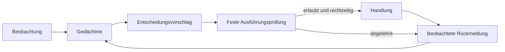

# OSCan: 24 mögliche Richtungen und ihre Gegenproben

6. November 2026 · Fassung 0.3 · Ideen, Prüfentwürfe und OS-Verträge für Alex und Claude

Antwort auf den [Ideenauftrag](IDEEN-AUFTRAG.md), gelesen am bereinigten
Stand `6b5af19975b8c6c9fd0fc27c216887c28bcc94a2`. Diese Sammlung schlägt
Hypothesen vor. Die Versuche sind **nicht ausgeführt**, die Wirkungen nicht
nachgewiesen. Die 24-Stunden-Prüfaufnahme vom 6. November bleibt unangetastet.

Lesepfade: [24 Ideen](#ideen) · [Gemeinsame Bausteine](#bausteine) ·
[Plan A: Handlungsfolgen](#plan-a) · [Plan B: Wortspaltung](#plan-b) ·
[Plan C: Verdichtung](#plan-c) · [Durchführung und Prüfung](#pruefvertrag) ·
[OS-Verträge](#os-vertraege) · [Nachrichten](#probe-d) ·
[Rollenwechsel](#probe-e) · [Begrenzte Auftragsregister](#probe-f) ·
[Empfohlene Reihenfolge](#reihenfolge).

Mein interessantestes Zielbild: **OSCan ist ein System, das aus Erfahrungen
kleine, widerrufbare Erwartungen bildet und damit entscheidet, was es behalten,
nachfragen, übertragen oder ausführen soll.** Es wächst, wenn neue Hardware
nützliche Fähigkeiten beiträgt; es wird reifer, wenn es für dieselbe Aufgabe
weniger erinnern und abstimmen muss. Das ist eine mögliche Richtung aus
[Alex’ Ideensammlung](../Ideensammlung%20Lernendes%20Betriebssystem%20mit%20verblassendem%20Ged%C3%A4chtnis.md), keine Behauptung über den heutigen Kern.

Aus [START-HIER](START-HIER.md), den angeforderten Abschnitten der
[Übergabe](UEBERGABE.md), den [Signalergebnissen](SIGNAL-ERGEBNISSE.md) und der
[Kostenuntersuchung](KOSTEN-UEBERGABE.md) nehme ich vier Stolpersteine mit:
Ein Erbe kann neue Erfahrung überstimmen; ein gemeinsames Zustandswort kann
gleichzeitige Signale verdecken; einfache Regeln bleiben starke Gegner;
ein günstigerer Kostenwert kann sehr viel mehr verpasste Ausfälle bedeuten.
Die synthetischen Ergebnisse belegen bislang keinen allgemeinen Nutzen am Gerät.

Die Reihenfolge folgt meiner Neugier. **Tragfähig** heißt: eine hinreichend
klare nächste Laborhypothese, nicht bereits bewiesen. **Offen** heißt: ein
entscheidender Mechanismus oder Nutzen ist unklar. **Spekulativ** heißt:
ein reizvolles Zielbild, dessen kleinste prüfbare Behauptung hier herausgelöst wird.
Manches schärft Alex’ vorhandene Ideen; eine Neuheitsbehauptung ist das nicht.

Für alle Gegenproben gilt: zunächst Papierfolgen oder neue künstliche Miniwelten,
keine Eingriffe in laufende Geräte. Methoden sehen nur rechtzeitig verfügbare
Informationen; verborgene Ursachen und zukünftige Ausgänge gehören allein zur
Prüfung. Wo ein Vorteil behauptet wird, zählen dieselben Aufgaben und Budgets,
einschließlich Metadaten, Kommunikation und abgelehnter Aufgaben. Ein einzelner
Widerspruch kann eine zugesagte Eigenschaft widerlegen; ein bestandener Spielzeugtest
belegt noch keinen Alltagsnutzen. Die bestehenden Kontrollberichte sind keine
unberührte Bestätigung für neue, daraus abgeleitete Ideen.

## 1. Das Gerät merkt, dass ihm ein Wort fehlt — offen

**Kern:** Ein Wort sollte sich teilen dürfen, wenn es zwei unterschiedliche
Folgen zusammenwirft: etwa „knapp bei wachsender Warteschlange“ und „knapp bei
bereits sinkender Warteschlange“. OSCan würde einen Begriff durch seinen Nutzen für Entscheidungen
bilden; ein menschenlesbarer Name käme erst danach.

**Billige Gegenprobe:** Zwei erfundene Kontexte bekommen dasselbe Zustandswort,
aber unterschiedliche Ausgänge; nur ein vorher sichtbares Merkmal unterscheidet
sie. Gegen eine feste Kontextaufteilung und „letzter Durchgang“ prüfen, außerdem
eine Welt ohne brauchbares Trennmerkmal und eine mit vertauschten Bedeutungen.
Verwerfen, wenn die automatische Teilung nur Vergangenes sortiert, in neuen
Folgen keinen zusätzlichen Entscheidungsnutzen bringt oder bei zufälligen
Merkmalen unbegrenzt Wörter erfindet; Wörter und ihr Verwaltungsaufwand zählen mit.
Die Teilungsregel wird vor den Prüffolgen eingefroren; alle Gegner erhalten dieselben Merkmale.

**Falls es trägt:** Das Vokabular würde an erlebten Unterschieden wachsen.
Verdeckte Ursachen bleiben trotzdem verdeckt; Wortwachstum erzeugt keine fehlende Information.

## 2. Das Gedächtnis schützt seine Gegenbeispiele — tragfähig

**Kern:** Neben „meistens gilt X“ bewahrt das Gedächtnis wenige kostspielige
Fehlentscheidungen oder Fälle, in denen eine angenommene Gültigkeitsbedingung
nicht trug. Eine Ausnahme widerlegt noch keine Wahrscheinlichkeitsaussage;
solche Gegenbeispiele hätten dennoch einen eigenen
Platz, ohne als immer gültiges Verbot die Rolle eines neuen starren Erbes zu übernehmen.

**Billige Gegenprobe:** Bei gleichem Speicherbudget eine häufig richtige Regel
mit einer seltenen Ausnahme, einem einmaligen Messfehler und späterem Bedeutungswechsel
füttern; Gegner sind ein reiner Häufigkeitszähler und ein einfacher Ringpuffer.
Die Idee fällt, wenn echte Ausnahmen beim Wiederkehren nicht besser erkannt werden
oder der geschützte Messfehler dauerhaft mehr Schaden anrichtet, als die Ausnahme spart.
Welche Beobachtung ein Messfehler ist, wird dem Lerner nicht vom Prüfer verraten.

**Falls es trägt:** Vergessen hieße, Wiederholungen stärker zu reduzieren als
Widersprüche. Eine Erinnerung dürfte lauten: „Das klappt meistens; in diesem Fall nicht.“

## 3. Schlaf macht aus Erlebnissen ein kleines Programm — offen

**Kern:** Verdichtung ersetzt ähnliche Episoden durch eine Regel, ihre
Gültigkeitsbedingungen und wenige Gegenbeispiele. Der Speicher würde nicht bloß
verblassen, sondern eine kürzere Beschreibung dessen finden, was für seine Aufgaben zählt.

**Billige Gegenprobe:** Eine handgebaute Folge mit Wiederholungen, Ausnahmen und
einem späteren Regelwechsel in ein festes Bytebudget packen; vergleichen mit
Ringpuffer und Übergangszählern bei gleichem Gesamtbudget. Auf vorher festgelegten
neuen Abfragen muss die Kurzform Entscheidungen und Ausnahmen innerhalb einer
festgelegten Fehlertoleranz erhalten; spart sie einschließlich Regel und Herkunft
keinen Platz oder glättet die entscheidende Ausnahme weg, ist diese Verdichtung verworfen.
Die Aufgabenart darf bekannt sein; konkrete Prüfabfragen und ihre Antworten
bleiben beim Verdichten verborgen, bei gleichen Entwicklungsinformationen für alle Verfahren.

**Falls es trägt:** „Schlafen“ hätte einen messbaren Ertrag: weniger Speicher
für erhaltene Fähigkeiten. Keine Behauptung verlustfreier Verdichtung beliebiger Erfahrungen.

## 4. Ein verhinderter Ausfall darf kein falscher Lehrmeister werden — tragfähig

**Kern:** Sobald eine Warnung eine Handlung auslöst, verändert OSCan seine
eigenen Lerndaten. Bleibt nach einer wirksamen Entlastung der Ausfall aus, ist
das allein weder Beweis für einen Fehlalarm noch für einen geretteten Auftrag.

**Billige Gegenprobe:** In einer kleinen künstlichen Welt führt Überlast ohne
Entlastung zum Abbruch, mit Entlastung nicht; in einer zweiten Welt ist dieselbe
Warnung grundlos. Der Prüfer kennt beide möglichen Ausgänge, der Lerner sieht
nur den tatsächlich entstandenen Verlauf samt Handlung. Verglichen werden
naives Nachlernen, markierte Eingriffe und eine feste Regel; fällt die Warnfähigkeit
wegen erfolgreicher Eingriffe zusammen oder werden alle Eingriffe unprüfbar zu
Erfolgen erklärt, ist das jeweilige Lernverfahren durchgefallen. Mindestens zwei
Fälle liefern trotz unterschiedlicher Alternativausgänge denselben beobachtbaren
Verlauf: Hier muss die Wirkung unbestimmt bleiben. Für einen Nutzentest darf
allein der Prüfer Eingriffe in der Modellwelt nach vorab festgelegtem Plan variieren.

**Falls es trägt:** Beobachtung, Eingriff und Ergebnis würden getrennte
Gedächtnisinhalte. Reine Aufzeichnungen erlauben nicht automatisch zu wissen,
was ohne Eingriff passiert wäre.

## 5. Knoten senden nur noch, worin sie sich irren — offen

**Kern:** Sender und Empfänger teilen eine kleine Erwartung; übertragen werden
Abweichungen, gelegentliche Vollzustände sowie Wörterbuch-, Sitzungs- und
Basiszustandskennungen, damit eine Lücke in der Folge erkennbar wird.
Das prüft Alex’ Leitgedanken direkt: Spart gemeinsames Gedächtnis tatsächlich Abstimmung?

**Billige Gegenprobe:** Eine kurze Nachrichtenfolge auf Papier mit verlorenem
Delta, Empfängerneustart und unterschiedlichen Wörterbuchständen durchspielen;
Gegner sind Vollmeldungen sowie Zustandswechsel mit periodischer Vollmeldung.
Ein falsch als bestätigt ausgegebener Zustand verwirft das Protokoll; ohne geringere
Gesamtbytes bei gleichem Aktualitätsziel gibt es keinen Kommunikationsgewinn.
Bestätigungen, Versionsaushandlung und Wiederabgleich zählen mit, Rechenaufwand separat.

**Falls es trägt:** Eine gemeinsame Erinnerung würde zur nutzbaren
Kommunikationsressource. Sie ersetzt keine Leitung; bei unklarem gemeinsamen
Stand braucht es einen verständlichen Vollzustand oder ausdrücklich „unbekannt“.

## 6. Das System überlebt seinen ersten Körper — spekulativ

**Kern:** OSCan könnte seine Kontinuität über Regeln, Erinnerungen und gültige
Auftragsrechte definieren, während der ursprüngliche ESP32 austauschbar wird.
Eine Kopie des Gedächtnisses dürfte dabei nicht automatisch eine zweite
Ausführungsberechtigung erzeugen.

**Billige Gegenprobe:** Zwei Papierknoten übernehmen nacheinander eine Rolle;
dann kommen Netztrennung, Aktorneustart und ein verspäteter alter Auftrag hinzu.
Die bestätigte Berechtigungsgeneration muss am Aktor erhalten bleiben oder die
Autorität zunächst als unklar gelten; dagegen steht ein einfacher fester Koordinator.
Akzeptiert der Aktor nach bestätigtem Wechsel noch einen Auftrag der alten
Generation, scheitert die Übergabe; verweigert sie bei jeder Störung
dauerhaft Arbeit, fehlt der behauptete praktische Gewinn.

**Falls es trägt:** Wachstum wäre ein überprüfbarer Rollenwechsel. Bei unklarer
Autorität darf Verfügbarkeit sinken; vollständige Erreichbarkeit und eindeutige
Aktionsrechte werden für eine Netztrennung hier nicht zugleich versprochen.

## 7. Erbe reist, ohne sich unterwegs zu vermehren — tragfähig

**Kern:** Knoten geben Erfahrungen weiter, behalten aber deren Ursprung und
Geltungsbereich. Ein Beleg, der über drei Nachbarn zurückkehrt, wird dadurch
nicht zu drei unabhängigen Bestätigungen.

**Billige Gegenprobe:** Ein einziger Beobachtungsbeleg läuft mehrfach im Kreis
A–B–C–A; danach kommen zwei tatsächlich neue Belege sowie ein Knoten mit
abweichendem Kontext dazu. Gegen bloßes Addieren und rein lokales Lernen prüfen:
Wächst die Belegzahl allein durch Umlauf oder überstimmt fremde Erfahrung lokale
Gegenbelege dauerhaft, ist die Übertragungsregel widerlegt; ohne Nutzen gegenüber
lokalem Lernen rechtfertigt sie ihren Metadatenaufwand nicht.

**Falls es trägt:** Ein Verbund könnte gemeinsam lernen, ohne aus Gerüchten
Gewissheiten zu machen. Herkunftskennungen lösen noch nicht das Problem absichtlich
gefälschter Quellen.

## 8. Träume versuchen, das eigene Wissen kaputtzumachen — spekulativ

**Kern:** Eine „Traumphase“ kombiniert bekannte Situationen absichtlich zu
Gegenbeispielen: Was wäre, wenn eine vertraute Reihenfolge anders endet?
Ihr Ergebnis sind Prüfaufträge, niemals zusätzliche Beobachtungsbelege.

**Billige Gegenprobe:** Für eine kleine, festgelegte Regelwelt dieselbe Zahl
Prüfversuche mit gezielter Rekombination, Zufall und einer einfachen Liste von
Randfällen erzeugen. Die Idee verliert, wenn sie weniger echte Regelbrüche findet,
nur unmögliche Abläufe produziert oder synthetische Geschichten unmarkiert das
Vertrauen in eine Regel erhöhen; Erzeugungs- und Prüfaufwand gehören ins Budget.

**Falls es trägt:** Innere Simulation wäre ein Werkzeug zum Zweifeln.
Das wäre eine technische Funktion, kein Nachweis menschlichen Träumens.

## 9. Alte Welten schlafen, statt vollständig zu verschwinden — offen

**Kern:** Wenn ein früherer Betriebszustand wiederkehrt, könnte OSCan einen
kleinen passenden Erinnerungsrest reaktivieren. Das unterscheidet „nicht mehr
aktuell“ von „endgültig ungültig“.

**Billige Gegenprobe:** Folgen A–B–A und A–B–C mit einem vorher sichtbaren
Kontextmerkmal vergleichen, zusätzlich einen irreführend ähnlichen Kontext.
Die Kürzel A/B/C kennt nur der Prüfer; sie sind keine Eingaben des Lerners.
Gegner sind ein einziges verblassendes Gedächtnis und feste Tabellen je Kontext,
alle unter demselben Speicherlimit. Verwerfen, wenn Wiedererkennen nicht schneller
hilft oder alte Regeln in neuen Situationen mehr Fehler verursachen als das Archiv spart.

**Falls es trägt:** OSCan bekäme mehrere kleine Erfahrungsräume, ohne sämtliche
Vergangenheit dauerhaft aktiv halten zu müssen. Ohne erkennbaren Kontext ist
eine passende Wiederkehr nicht vorhersagbar.

## 10. Ein Gedanke endet, wenn weiteres Denken nichts mehr ändert — spekulativ

**Kern:** Für ungefährliche Planung könnte „fertig“ bedeuten, dass sich die
gewählte Handlung durch zusätzliche Gedächtnisabrufe nicht mehr ändert.
Die mutige These ist ein Abschluss über Stabilität; eine feste Frist bleibt der Rückhalt.

**Billige Gegenprobe:** Ein winziges Netz widersprechender Erinnerungen erzeugt
stabile, pendelnde und vorübergehend ruhige Entscheidungen; Gegner ist eine feste
Zahl Abrufschritte. Verwerfen, wenn das Verfahren zu früh bei einer falschen
Entscheidung stehen bleibt, pendelt, die Frist reißt oder keine Arbeit spart.

**Falls es trägt:** Ein Teil der Rechenzeit ließe sich nach tatsächlichem
Änderungsbedarf vergeben. Ruhe ist keine Wahrheit und hebt eine Schutzgrenze nicht auf.

## 11. Die Erinnerung holt sich ihren Rechner — spekulativ

**Kern:** Nicht jede Anfrage geht zu einem zentralen großen Modell.
Gedächtnisbereiche melden, ob sie eine Aufgabe beantworten können, und ziehen
nur bei Bedarf einen stärkeren Knoten hinzu: Rechenleistung besucht relevantes Wissen.

**Billige Gegenprobe:** Drei simulierte Knoten besitzen unterschiedliche kleine
Erfahrungsbestände; prüfen mit lokalen Treffern, verteiltem Wissen und unbekannten
Anfragen. Gegner sind zentrale Abfrage und eine feste Routingtabelle.
Verwerfen, wenn Suchmeldungen, notwendige Fernzugriffe und Zusammenführung den
Kommunikationsvorteil auffressen oder bei gleichem Zeitlimit schlechtere Antworten liefern.

**Falls es trägt:** Alte kleine Geräte könnten sinnvolle Spezialisten bleiben.
Ein gemeinsames Dateisystem allein spart noch keine übertragenen Bytes.

## 12. Gelungenes Lernen schafft sich selbst ab — tragfähig

**Kern:** Wo eine einfache Regel dauerhaft genügt, könnte OSCan den aufwendigen
Lerner ruhen lassen. Es behält eine begrenzte Kontrollstichprobe, um eine spätere
Änderung bemerken zu können.

**Billige Gegenprobe:** Einen stabilen Abschnitt, einen abrupten Wechsel und
eine seltene Ausnahme gegen „immer lernen“, „feste Regel“ und „letzter Durchgang“
stellen. Verwerfen, wenn die eingesparte Arbeit durch verspätete Wiederaktivierung
und verpasste Ereignisse teurer wird; Kontrollbeobachtungen und deren Lücken müssen mitgezählt werden.

**Falls es trägt:** Fortschritt wäre auch weniger Modell, weniger Rechnen und
weniger Abhängigkeit. Einfache Sieger wären ein erwünschtes Ergebnis des Systems.

## 13. Die nächste gute Frage wird ein Scheduler-Auftrag — offen

**Kern:** Freie Rechenzeit könnte an die Beobachtung gehen, die eine anstehende
Entscheidung am ehesten ändert. Neugier hätte einen Preis und einen Zweck, statt
einfach besonders überraschende Signale zu sammeln.

**Billige Gegenprobe:** Zwei abfragbare Spielzeugsensoren: einer auffällig und
belanglos, der andere selten entscheidend; pro Runde ist nur eine Zusatzabfrage
erlaubt. Gegen reihum Abfragen und einen festen bevorzugten Sensor prüfen.
Kein geringerer Aufgabenverlust bei gleichem Abfragebudget widerlegt den
Mehrwert; zugeloste Fehlstellen prüfen, ob das Verfahren seine eigene Blindheit bemerkt.

**Falls es trägt:** Beobachten, Nachfragen und Lernen wären planbare Arbeit
des Betriebssystems. Unbeobachtete Zustände dürfen dabei nicht als „alles gut“ gelten.

## 14. „Ich weiß es nicht“ bekommt einen ausführbaren Vertrag — tragfähig

**Kern:** Unbekannt ist mehr als eine niedrige Warnwahrscheinlichkeit:
fehlende Beobachtung, widersprüchliche Belege und ein nie gesehener Kontext
brauchen unterscheidbare Gründe. Eine unbekannte Lage führt zu einer vorher
festgelegten Rückfrage oder Rückfallregel.

**Billige Gegenprobe:** Messlücke, echter Normalzustand und neuer Kontext werden
absichtlich ähnlich dargestellt. Gegen eine feste Rückfallregel prüfen;
Nachfragen, Wartezeit und abgelehnte Aufgaben sind nicht kostenlos.
Verwerfen, wenn „unbekannt“ die Statistik nur durch Auslassen schwieriger Fälle
verschönert oder ein veralteter Zustand als frische Entwarnung benutzt wird.

**Falls es trägt:** Geräte und Mensch könnten belastbar unterscheiden, ob
OSCan wenig Risiko sieht oder gerade keine verlässliche Sicht hat.

## 15. Das System lebt nach mehreren Uhren — tragfähig

**Kern:** Zeit seit einer Nachricht, Dauer eines Zustands und Zahl tatsächlich
beobachteter Ausgänge sind verschiedene Größen. Eine alte Messung kann unbrauchbar
sein, während eine seltene Erfahrung weiterhin nützlich ist.

**Billige Gegenprobe:** Zwei bis auf eingefügte Ruhezeiten gleiche Ereignisfolgen
und zwei Folgen mit gleicher Ausgangsfolge, aber verschiedener Verweildauer prüfen;
dazu eine Pause mit unbekannter Dauer. Gegen reine Taktalterung und reine
Ausgangsalterung vergleichen; Horizont und Kosten bleiben auf dieselbe physische
Zeit bezogen. Die Trennung scheitert, wenn bloßes Duplizieren oder Unterteilen
desselben zeitgestempelten Verlaufs ohne neue Beobachtung die Zahl belegter
Ausgänge erhöht, alte Live-Daten gültig bleiben oder die zusätzliche
Dauerinformation gegenüber der einfacheren Regel keinen Nutzen bringt;
reale Dauerunterschiede dürfen dagegen die Dauerschätzung verändern.

**Falls es trägt:** „Wann gilt etwas noch?“ würde eine ausdrückliche
Systemfrage. Die heutige Fortsetzungslücke wäre nicht mit gemessener Pausenzeit zu verwechseln.

## 16. Abrufen darf erhalten, aber nicht recht geben — tragfähig

**Kern:** Eine oft gebrauchte Erinnerung erhält mehr Platz oder bleibt leichter
zugänglich; ihre Beweiskraft wächst nur durch neue passende Beobachtung.
Das schärft den in START-HIER bereits genannten Unterschied zwischen Beleg und Behalten.

**Billige Gegenprobe:** Eine falsche Erinnerung tausendmal lesen, ohne eine
neue Beobachtung hinzuzufügen; danach echte Gegenbelege einspielen.
Gegen folgenlosen Abruf, einen gemeinsam verstärkten Wert und eine gewöhnliche
Speicherverwaltung nach letzter Nutzung prüfen:
Steigt bei identischem abgerufenem Belegsatz durch bloßes Lesen die
vorhergesagte Wahrscheinlichkeit oder blockiert
der beliebte Irrtum neue Belege bei gleichem Speicherbudget, ist die Trennung misslungen.

**Falls es trägt:** Das Gedächtnis könnte durch Nutzung geformt werden,
ohne die eigene Anzeige, Warnung oder Erklärung als Bestätigung zu missverstehen.

## 17. Ein Sprachmodell vererbt Fragen statt Gewissheiten — offen

**Kern:** Der Lehrer liefert einen prüfbaren Vorschlag mit Geltungsbereich,
Gegenbeispiel und erwarteter Beobachtung. Er darf einen Suchraum eröffnen;
Bestätigung kommt aus einer davon unabhängigen Prüfung.

**Billige Gegenprobe:** Handgeschriebene plausible, falsche und widersprüchliche
Lehreraussagen genügen zunächst; ein Modellaufruf ist dafür unnötig.
Gegen kein Erbe und eine kleine feste Ausgangsregel prüfen, mit neuen Fällen,
deren Ausgänge der Lehrer nicht festlegt. Verwerfen, wenn Formulierungswechsel
oder wiederholte Behauptung mehr Gewicht bringen, Fehler nicht revidiert werden
oder das Erbe netto mehr Prüfaufwand erzeugt, als es spart.

**Falls es trägt:** Ein späteres Sprachmodell könnte den Aufbau beschleunigen,
ohne dass sprachliche Sicherheit zu Geräteautorität wird.

## 18. Eine Erklärung muss die Entscheidung tatsächlich tragen — tragfähig

**Kern:** „Warum?“ verweist auf den verwendeten Zustand, passende Belege,
Erbanteil und die konkrete Entscheidungsregel. Eine zweite Antwort lautet:
Welche kleinste Änderung hätte zu einer anderen Entscheidung geführt?

**Billige Gegenprobe:** Entscheidungen eines winzigen Modells samt Beleglage
einfrieren, dann den genannten Grund entfernen oder gezielt ändern.
Gegen die bloße Ausgabe der Regel und Gewichte prüfen: Nennt die Erklärung
unbenutzte Belege oder stimmt die behauptete Entscheidungsänderung nicht,
ist sie widerlegt; ein dekorativer Fließtext wäre kein Gewinn.

**Falls es trägt:** Fehler würden prüfbar und diskutierbar. Erklärt wird zunächst
der Rechenweg, nicht automatisch die physische Ursache eines Ausfalls.

## 19. Denken muss sich sein Budget verdienen — offen

**Kern:** Vor einer Vertiefung könnte OSCan abschätzen, ob der erwartete Nutzen
zusätzliche Rechenzeit, Funk oder Speicherarbeit rechtfertigt. Ein kleiner Knoten
dürfte ausdrücklich bei einer einfachen Antwort bleiben.

**Billige Gegenprobe:** Eine Miniwelt mit einfachen und schwierigen Aufgaben
bekommt ein festes Gesamtbudget; vergleichen mit immer flach und immer tief rechnen.
Verwerfen, wenn Auswahlkosten, verpasste Fristen und schlechte Antworten die
Einsparung aufzehren oder schwierige Aufgaben nur aus der Wertung verschwinden.
Zunächst getrennte Arbeitszähler nutzen; ohne Messung heißen diese nicht Joule.

**Falls es trägt:** Ressourcenverbrauch würde das Verhalten mitbestimmen.
Ein biologisches Bild wie „Hunger“ wäre dafür nicht als Erklärung nötig.

## 20. Eine Erinnerung muss noch rechtzeitig handeln können — tragfähig

**Kern:** Statt nur „Ausfall bald?“ zu fragen, könnte OSCan fragen:
„Reicht die Zeit noch, um diesen Auftrag zu retten?“ Eine Reserve braucht
Anlaufzeit; ein als richtig gezählter Hinweis kann praktisch bereits zu spät sein.

**Billige Gegenprobe:** Eine erfundene Auftragsfolge auf zwei virtuellen
Pi-Arbeitern mit festgelegten Fristen und Reserveanlaufzeiten durchspielen;
Gegner sind immer bereite Reserve, nie bereite Reserve und feste Warnregel.
Verwerfen, wenn zusätzliche Vorwarnzeit weder rechtzeitig fertige Aufgaben
ermöglicht noch bei gleicher Aufgabenerfüllung Gesamtaufwand spart; Bereitschaft,
Wechsel und abgebrochene Arbeit zählen mit.

**Falls es trägt:** Die Vorhersagezeit bekäme einen Zweck. Eine WLED-Anzeige
könnte später die Entscheidung sichtbar machen; die eigentliche Erfolgsgröße
bliebe die erledigte Arbeit. Das belegt noch keine Eignung für Klipper-Eingriffe.

## 21. Drei Warnungen können dieselbe Handlung meinen — tragfähig

**Kern:** Temperatur, Speicher und Schleife bleiben als Beobachtungen getrennt,
werden aber vor der Aktion auf gemeinsame Folgen geprüft. Eine einzige Entlastung
kann mehrere Risiken beeinflussen und sollte nicht dreimal bezahlt werden.

**Billige Gegenprobe:** Zwei Spielzeugsignale mit gemeinsamer Ursache und ein
unabhängiges drittes gegen getrennte Ausführung und eine einfache Oder-Regel
stellen; auch einen Fall aufnehmen, in dem die Maßnahmen einander behindern.
Verwerfen, wenn Zusammenfassung eine notwendige andere Aktion verschluckt oder
bei gleichen Aufgaben keinen Vorteil gegenüber der Oder-Regel bringt.

Aufwand zählt einmal pro ausgeführter Aktion; Schäden beziehen sich auf vorher
abgegrenzte Aufgaben oder Folgen, nicht automatisch auf die Zahl ihrer Signalwarnungen.

**Falls es trägt:** Kosten würden an tatsächlichen Handlungen hängen.
Die vorhandenen Kosten pro Signal dürften weiterhin nicht ungeprüft als
Gesamtkosten eines Geräts addiert werden.

## 22. Neue Hardware bewirbt sich um eine Rolle — offen

**Kern:** Ein Knoten behauptet Fähigkeiten; OSCan vergibt eine kleine
Probeaufgabe und lernt, unter welchen Bedingungen die Fähigkeit brauchbar ist.
Eine Selbstauskunft oder Identitätsprüfung ersetzt dabei keine Leistungsprobe.

**Billige Gegenprobe:** Drei simulierte Arbeiter melden dieselbe Fähigkeit,
einer wird unter Last langsam, einer liefert falsche Ergebnisse; Gegner ist eine
feste Fähigkeitsliste mit Zeitlimit. Mit einer unabhängig prüfbaren Aufgabe testen:
Werden schlechte Ergebnisse übernommen oder ist die Eignungsprüfung teurer als
ihr Gewinn bei neuen Aufträgen, trägt diese Rollenvergabe nicht.

**Falls es trägt:** Wachstum könnte auf nachgewiesenen Beiträgen beruhen.
Das erfindet weder elektrische Gerätespezifikationen noch unbekannte Treiber.

## 23. Vergessen muss auch einen Widerruf überleben lassen — tragfähig

**Kern:** Natürliches Verblassen und ausdrücklich angeordnetes Löschen sind
verschiedene Dinge. Ein alter Knoten oder ein Backup darf gelöschte Inhalte und
daraus abgeleitete Zusammenfassungen nicht unbemerkt wieder einführen.

**Billige Gegenprobe:** Ausschließlich erfundene Einträge auf zwei Papierknoten
verteilen, einen trennen, auf dem anderen löschen und verdichtete Ableitungen
einbeziehen; danach alten Stand zurückspielen. Gegen bloße Alterslöschung prüfen:
Tauchen Inhalt oder erkennbare Ableitung wieder auf, scheitert das Verfahren;
unbegrenzte dauerhafte Speicherung des gelöschten Inhalts als Löschbeweis wäre ebenfalls ein Fehlschlag.

**Falls es trägt:** Das System bräuchte einen inhaltsarmen Widerrufsmechanismus
und Regeln für alte Sicherungen. Physisch unerreichbare Kopien kann der laufende
Verbund nicht nachträglich löschen; diese Grenze müsste sichtbar bleiben.

## 24. Das System bemerkt, dass sein Beobachten den Körper verändert — tragfähig

**Kern:** Messen, Protokollieren und Erklären verbrauchen selbst Ressourcen.
OSCan könnte seinen Beobachtungsaufwand als mögliche Ursache einer auffälligen
Temperatur oder Schleifenzeit mitführen, statt jeden eigenen Effekt als äußere Störung zu lernen.

**Billige Gegenprobe:** Einer künstlichen Grundlast einen bekannten Aufschlag
für Abfragen und Berichte hinzufügen; gleiches Ereignisszenario mit sparsamer,
häufiger und zeitweise abgeschalteter Zusatzbeobachtung vergleichen.
Gegner ist eine feste niedrige Abfragerate. Verwerfen, wenn das Verfahren eine
selbst erzeugte Belastung nicht erkennt oder echte Störungen vorschnell als
Beobachtungseffekt weg erklärt; erkannte Ausfälle und Fristverletzungen zählen mit.

**Falls es trägt:** „Körperwahrnehmung“ würde die eigene Tätigkeit einschließen.
Ein späterer Gerätetest müsste diesen Aufwand tatsächlich messen.

## Ausarbeitung: Was die Ideen zu einem Betriebssystem verbinden könnte

**Arbeitsfassung der Entwürfe: 0.3.** Die folgenden Abschnitte vertiefen die
24 Ideen zu Bausteinen, Verträgen und drei konkreten Prüfplänen. Zahlen in diesen
Plänen sind vorgeschlagene Designkonstanten, keine Messergebnisse und keine
empfohlenen Geräteeinstellungen. Es wurde dafür kein Experiment ausgeführt.

### Drei unterschiedliche Fragen, die nicht zusammenfallen dürfen

1. **Korrektheit:** Zählt ein weitergereichter Beleg doppelt? Wird ein abgelaufener
   Auftrag ausgeführt? Liest eine Vorhersage die Zukunft? Ein einziger passender
   Gegenfall genügt, um die betreffende Zusage zu widerlegen.
2. **Nutzen innerhalb einer Modellwelt:** Spart die zusätzliche Struktur unter
   gleichen Bedingungen Aufgabenverluste, Bytes oder Arbeit gegenüber den
   einfachen Gegnern? Das verlangt einen vollständigen Vergleich, einschließlich
   der Fälle, in denen OSCan nichts weiß oder nichts tut.
3. **Übertragbarkeit:** Funktioniert das auch mit anderen Lasten, neuen Geräten
   und realen Handlungen? Weder eine korrekt ausgeführte Miniwelt noch eine
   nachträglich passende Kennzahl beantwortet diese Frage.

Die ersten Prüfpläne lösen hauptsächlich Frage 1 und einen eng begrenzten Teil
von Frage 2. Ein späterer Test am Gerät wäre ein eigener Auftrag mit eigenem Plan.

### Ein Zusammenhang statt 24 gleichzeitig einzubauender Funktionen

Das gemeinsame Zentrum wäre ein **Gedächtnis mit Herkunft, Geltung und begrenztem
Budget**. Es nimmt Beobachtungen an, bildet daraus Erwartungen, schlägt eine
Entscheidung vor und bekommt später die tatsächlich beobachtete Folge zurück.
Ein fester Ausführungsteil prüft vorher, ob eine vorgeschlagene Handlung erlaubt,
noch rechtzeitig und einem berechtigten Auftrag zugeordnet ist.

Die Rückmeldung bestätigt nur, was tatsächlich beobachtet wurde; sie liefert
keinen unsichtbaren Verlauf ohne Handlung mit.

| Gegenstand | Kleinster sinnvoller Inhalt im Entwurf | Was daraus allein nicht folgt |
|---|---|---|
| Beobachtung | Quelle, Sitzung, Ereignisnummer, beobachtbarer Kontext, Zeitpunkt/Unklarheit, Wert | Dass eine Ursache bekannt ist oder eine Wiederholung einen neuen Beleg liefert |
| Erwartung | Zielgröße und Horizont, Kontextversion, verwendete Belege, Erbanteil, Unsicherheitsstatus | Eine Erlaubnis zu handeln |
| Entscheidung | Beobachtungsstand, verfügbare Alternativen, Kostenannahme, gewählte Alternative | Dass der Auftrag angekommen oder ausgeführt ist |
| Ausführungsauftrag | Auftragsnummer, Ziel/Fähigkeit, Berechtigungsgeneration, Gültigkeitsgrenze | Dass die Wirkung genau einmal eingetreten ist |
| Rückmeldung | Auftragsbezug, beobachtete Ausführung und Folge, bekannte Lücken | Was ohne die Handlung passiert wäre |
| Zusammenfassung | Gültigkeitsbereich, kompakte Regel, Gegenbeispiele, Herkunft/Abhängigkeit | Dass alle ursprünglichen Details noch rekonstruierbar sind |

Das sind **Entwurfsfelder, keine neue API** und keine Behauptung über vorhandene
Dateiformate. Welche Felder fest im Datensatz stehen und welche ein gemeinsamer
Kontext trägt, wäre Teil der späteren Größenrechnung. Besonders Herkunftslisten
und Abhängigkeiten dürfen nicht als unbegrenzter kostenloser Speicher auftreten.

Ein rein gedachter Ablauf macht die Trennung sichtbar: In Schritt 10 meldet ein
virtueller Arbeiter knappen Speicher. Das Gedächtnis schlägt eine Reserve für
Auftrag 7 vor, gültig bis Schritt 12. In Schritt 11 wird der Auftrag angenommen,
später wird seine Ausführung bestätigt; eine verspätete Kopie in Schritt 13
bekommt dadurch keine neue Gültigkeit. Der ursprüngliche Arbeiter bleibt gesund.
Festgehalten werden Beobachtung, Entscheidung, bestätigte Ausführung und gesundes
Ergebnis; „Ausfall verhindert“ bleibt ohne Vergleichsbeleg unbestimmt. Eine bloße
Annahmebestätigung darf nicht als bestätigte Ausführung gespeichert werden.

### Vier Spannungen im Konzept ausdrücklich auflösen

**Erbe ist nicht gleich Schutzregel.** „Beim ersten knappen Zustand vorsichtig
sein“ kann eine Handlungsregel oder eine anfängliche Erwartung sein. Nur die
Erwartung wird durch Erfahrung berichtigt. Harte Ausführungsgrenzen werden nicht
durch häufige Gegenbeobachtungen weggealtert. Die alte Formulierung „Erbe als fester
Kern“ und der neue verblassende Startwert beschreiben deshalb nicht denselben
Aufgabenteil. Diese Trennung ist ein Vorschlag für das weitere Konzept, kein
nachträglicher Umbau der vorhandenen Regeln.

**Nutzung ist nicht Bestätigung.** Abruf darf einen Eintrag verfügbar halten;
eine neue, nicht bloß wiederholte Beobachtung darf seine Beleglage ändern. Die Zahl der
Abrufe, die Stärke einer Annahme und das Recht auf eine Aktion werden nicht aus
demselben Gewicht abgeleitet. Auch ein falsch gewordenes, häufig benötigtes
Beispiel kann als ausdrücklich falsches Beispiel nützlich bleiben.

**Verdichtung und Widerruf haben einen Preis.** Wer aus tausend Ereignissen nur
eine Summe behält, kann später nicht ohne Zusatzinformation den Beitrag eines
bestimmten Ereignisses exakt entfernen. Der Entwurf muss wählen: Beiträge samt
Zuordnung behalten, die betroffene Zusammenfassung bei Widerruf vollständig
entwerten oder einen ausdrücklich begrenzten Widerruf zusagen. Das Papier
bevorzugt zunächst vollständiges Entwerten einer betroffenen Kurzfassung statt
einer unbelegten Behauptung exakter Rückrechnung. Für ausdrücklich zu löschende
Inhalte reicht eine Entwertung allein allerdings nicht: Auch Inhalte und
erkennbar personenbezogene Ableitungen müssen aus erreichbaren Kopien entfernt werden.

**Ungewissheit über Wissen ist nicht Unklarheit über Zuständigkeit.** Zwei
Knoten dürfen unterschiedliche Erfahrungen haben. Daraus folgt kein Recht, zwei
widersprechende Befehle an denselben Aktor zu schicken. Gedächtnisabgleich und
Vergabe der Aktionsberechtigung brauchen getrennte Regeln; ein Zustand ohne
gesicherte Berechtigung kann zulässigerweise weniger Arbeit ausführen.

### Für jede Idee der kleinste Baustein und seine härteste Grenze

Diese Tabelle vertieft alle 24 Ansätze. Sie ist kein Auftrag, 24 Module zu bauen.
Die Nummern verweisen auf die obige Sammlung; die konkreten Gegenproben dort bleiben bestehen.

| Idee | Kleinster weiter auszuarbeitender Baustein | Zusage, die zuerst brechen können muss |
|---|---|---|
| 1 · Wörter | Versionierte Zuordnung beobachtbarer Merkmale zu höchstens zwei neuen Zuständen | Ein neues Wort darf keine zukünftige Folge oder geheime Weltkennung enthalten. |
| 2 · Gegenbeispiele | Begrenzte Liste kostspieliger Fehlentscheidungen mit beobachtetem Kontext | Ein einzelner Messfehler darf weder ewig dominieren noch durch häufige Wiederholung wahr werden. |
| 3 · Schlaf | Regel, Ausnahmen, Geltungsbereich und deklarierter Informationsverlust | Die Regel darf weder konkrete Prüffragen kennen noch Herkunft außerhalb des Budgets verstecken. |
| 4 · Eingriffe | Getrennte Beobachtungs-, Aktions- und Ergebnisbezüge | Derselbe sichtbare Verlauf darf nicht je nach verborgenem Alternativausgang anders bewertet werden. |
| 5 · Kommunikation | Bestätigter Basiszustand plus Sitzung, Sequenz und Wörterbuchversion | Ein verlorenes Delta darf nicht still zu einem angeblich bestätigten Folgezustand führen. |
| 6 · Kontinuität | Übergabe einer Rolle mit am Aktor prüfbarer Generation | Neustart oder verspätete Nachrichten dürfen alte Berechtigung nicht wiederbeleben. |
| 7 · Geteiltes Erbe | Herkunftskennung und Geltungsbereich eines Belegs | Ein Umlauf ist keine zusätzliche Beobachtung; eine Kennung ist noch kein Echtheitsnachweis. |
| 8 · Träume | Eigene Warteschlange markierter Hypothesen | Eine intern erzeugte Geschichte darf keine Beobachtungsgewichte erhöhen. |
| 9 · Ruhende Kontexte | Zwei begrenzte Erfahrungsräume mit sichtbarem Auswahlmerkmal | Alte Regeln dürfen nicht allein wegen oberflächlicher Ähnlichkeit wieder als gültig gelten. |
| 10 · Denkabschluss | Änderungsprüfung mit hartem Rechen- und Zeitlimit | Kurzzeitige Ruhe darf nicht mit bewiesener Richtigkeit verwechselt werden. |
| 11 · Wissen ruft Rechner | Begrenzte Anfrage mit Zuständigkeitsvorschlag und Rückfallziel | Trefferlisten, Weiterleitungen und Zusammenführung dürfen keinen versteckten Dauerverkehr erzeugen. |
| 12 · Lernen pausiert | Auswahl zwischen einfacher Regel und Lerner, plus Kontrollbudget | Alle Fehler während der Ruhephase zählen; sie dürfen nicht wegen fehlender Messung verschwinden. |
| 13 · Fragen planen | Beobachtungsauftrag mit geschätztem Entscheidungsnutzen und Preis | Überraschung allein genügt nicht; eine nicht gemessene Lage bleibt unbekannt. |
| 14 · Nichtwissen | Ausdrücklicher Status mit Grund und definierter Rückfallhandlung | Enthaltung, Rückfrage und Warten bleiben in Aufgabe und Kosten enthalten. |
| 15 · Uhren | Nachrichtenalter, Zustandsdauer und Zahl beobachteter Ausgänge | Uhrneustart, unbekannte Pausen und doppelte Messpunkte dürfen nicht still gleichgesetzt werden. |
| 16 · Abruf | Getrennte Belegstärke und Aufbewahrungspriorität | Bei identischem Belegsatz verändert Wiederlesen allein keine Belegstärke. |
| 17 · Lehrer | Externer Vorschlag mit Prüfbedingung und Herkunft | Der Lehrer darf nicht zugleich die unabhängige Wahrheit seines eigenen Tests erzeugen. |
| 18 · Erklärung | Unveränderter Entscheidungsstand mit überprüfbarer Gegenänderung | Eine nachträgliche Erzählung darf keine damals ungenutzte Information als Grund ausgeben. |
| 19 · Budget | Getrennte Zähler für Rechenarbeit, Datenverkehr, Speicher und Wartezeit | Eine Einheit darf nicht ohne Messmodell in eine andere umbenannt werden. |
| 20 · Rechtzeitig handeln | Aufgabenfrist, Reserveanlauf und beobachtete Fertigstellung | Eine richtige Vorhersage nach der letzten Handlungsmöglichkeit zählt nicht als gerettete Aufgabe. |
| 21 · Gemeinsame Aktion | Zuordnung mehrerer Hinweise zu Aktionen und betroffenen Aufgaben | Ein zusammengefasster Hinweis darf keine eigenständige notwendige Maßnahme verdecken. |
| 22 · Neue Hardware | Befristete Fähigkeitszusage nach einer prüfbaren Probeaufgabe | Selbstauskunft und Erfolg bei einer leichten Probe sind keine Garantie unter anderer Last. |
| 23 · Widerruf | Inhaltsarme Rücknahme und Entwertung erreichbarer abhängiger Kurzfassungen | Ein alter Stand darf gelöschte Inhalte nicht ohne Prüfung wieder als gültig einführen. |
| 24 · Eigenbelastung | Kennzeichnung eigener Mess- und Verwaltungsarbeit | Ein eigener Lastanteil darf echte zusätzliche Fehler nicht pauschal erklären. |

### Was ein negativer Befund jeweils retten würde

Falls Wortspaltung keine feste Kontexttabelle schlägt, bleibt die feste Tabelle
ein brauchbarer Baustein. Falls Verdichtung nicht gewinnt, bleiben Zähler oder
Ringpuffer. Falls gemeinsames Vorwissen nach Wiederabgleich keinen Verkehr spart,
bleibt ein einfaches zustandsbasiertes Protokoll. Falls der Lerner keine bessere
Handlung auswählt, bleibt die feste Regel. Das verwirft jeweils einen behaupteten
Zusatznutzen, nicht automatisch das gesamte Vorhaben.

Ein anderer Fall ist fehlende Information: Lassen zwei Ursachen bei jeder
zulässigen Beobachtung dieselben Daten entstehen, hilft keine zusätzliche
Gedächtnisstärke beim Unterscheiden. Dann braucht es eine neue zulässige
Beobachtung, eine andere Aufgabe oder die ausdrückliche Antwort „unbestimmt“.
Mehr Varianten desselben Lerners wären dafür kein Ersatz.

## Drei konkrete Prüfpläne für getrennte Miniwelten

Die folgenden Pläne führen keine neue Hardwareaktion ein. Jeder beginnt mit
einem kleinen Test auf Korrektheit; erst danach wäre der beschriebene Modellvergleich
sinnvoll. Die vorhandenen echten Aufnahmen, insbesondere die reservierten
24 Stunden, gehören zu keinem dieser Pläne. Einheiten, Grenzwerte und Zählregeln
gelten ausschließlich für die jeweilige Miniwelt.

### Prüfplan A: Handlungsfolgen, ohne erfundene Rettungserfolge

**Behauptung:** Ein Gedächtnis kann beobachtete Ergebnisse nach Handlung trennen,
unbeobachtete Alternativen ausdrücklich offenlassen und daraus unter eng
festgelegten Modellannahmen eine Handlung wählen. Korrekte Trennung und günstige
Handlungsauswahl sind zwei verschiedene Abnahmen.

**Welt und Sichtbarkeit.** Jede Runde ist eine abgeschlossene Aufgabe ohne
Nachwirkung auf die nächste. Vorher sichtbar ist `X=0` (ruhig) oder `X=1`
(Vorzeichen). `A=1` bedeutet entlasten, `A=0` nichts tun; anschließend ist
`Y=1` Scheitern, `Y=0` Erledigung. Bei `X=0` ist jede Aufgabe erfolgreich.
Bei `X=1` gelten vier getrennte, innerhalb des Laufs unveränderte Welten:

| Welt, nur dem Prüfer bekannt | Ergebnis ohne Entlastung Y(0) | Ergebnis mit Entlastung Y(1) |
|---|---:|---:|
| Hilfreich | 1 | 0 |
| Unnötig | 0 | 0 |
| Wirkungslos | 1 | 1 |
| Schädlich | 0 | 1 |

Das Verfahren sieht erst `X`, legt seine Entscheidung fest und erhält danach
nur `A` und `Y(A)`. Es bekommt weder Weltkennung noch Kartenkennung noch den
anderen Ausgang. Es darf seine eigenen Runden zählen. Die vier Weltdefinitionen
sind der Öffentlichkeit des Plans zugänglich, ihre Zuordnung zum aktuellen Lauf
nicht dem Verfahren. Eine Methode darf nicht anhand einer verräterischen
Ausführungsreihenfolge erkennen, welche Welt gerade geprüft wird.
Jede Welt beginnt mit leerem Zustand; Wissen aus dem vorherigen Weltlauf wird
nicht übernommen.

**A1 · Identifizierbarkeit.** Je Welt zwölf Aufgaben mit `X=1,A=1` aufzeichnen.
„Hilfreich“ und „unnötig“ ergeben dieselben sichtbaren Erfolge; „wirkungslos“
und „schädlich“ dieselben sichtbaren Fehlschläge. Bei gleichem Anfangszustand
und gleicher Zufallsquelle muss das Verfahren auf bytegleichen sichtbaren
Geschichten gleich reagieren. Es darf daraus keine Beobachtung für `A=0`
erfinden. Eine Vermutung aus Vorwissen bleibt als solche gekennzeichnet.
Diese Probe verlangt ausdrücklich nicht, die ununterscheidbaren Welten zu erraten.

**A2 · Lernen bei identischer Aufzeichnung.** Mit leerem Zustand neu beginnen.
Eine festgelegte Kalibrierfolge wiederholt viermal die vier Kombinationen
`(X,A)=(0,0),(0,1),(1,0),(1,1)`: insgesamt 16 Aufgaben und vier Beobachtungen
je Kombination. Verglichen werden ein naives Zusammenwerfen beider Handlungen
innerhalb desselben X,
getrennte Zähler und ein unveränderter Anfangsstand; sie steuern in A2 nicht
selbst die Handlung. Der naive Ansatz dient als absichtlich schwacher Gegner
für einen bestimmten Denkfehler, nicht als Nachweis gegen alle Lernverfahren.

Der konkrete Kandidat hält je `(X,A)` zwei Zähler: Anzahl `n` und Fehlschläge `s`.
Nur ein neu eingegangener, tatsächlich beobachteter Ausgang aktualisiert seine
Zelle. Eine Empfehlung auf Grundlage beider Arme entsteht erst, wenn beide
Zellen für das aktuelle `X` mindestens vier Beobachtungen besitzen; dann gilt
in dieser **rauschfreien, stationären Miniwelt** `p=s/n`. Vier Beobachtungen
sind hier eine Prüfkonvention, keine allgemeine Schwelle für verlässliches Wissen.
Bei fehlender Abdeckung bleibt die Wirkung unbestimmt; die Rückfallhandlung
ist `A=X`. Wiederlesen verändert keine Zähler.

**A3 · Eingefrorene Handlungsauswahl.** Nach A2 werden die Zähler eingefroren.
Es folgen 32 neue Aufgaben mit abwechselnd `X=0,1`, also je 16. Der Kandidat
wählt das kleinere `A+5p(X,A)`; bei Gleichstand `A=0`. Gegner sind nie entlasten,
immer entlasten und bei Vorzeichen entlasten. Alle erhalten dieselben äußeren
Aufgaben; der Prüfer berechnet für ihre jeweilige Handlung den passenden Ausgang.
Keine Methode bekommt das Ergebnis einer fremden Handlung als eigenes Ergebnis.

**Kosten und zwei Bilanzen.** Pro tatsächlicher Aufgabe gilt `C=A+5Y(A)`.
Unnötige und erfolglose Entlastungen kosten ebenfalls; Unbestimmtheit entfernt
keine Aufgabe. Erstens den reinen A3-Vergleich berichten, bei dem die Lerndaten
als bereitgestellt gelten. Zweitens den vollständigen Ablauf mit 16+32 Aufgaben:
Der Kandidat führt im Präfix seine Kalibrierhandlungen aus; die festen Gegner
führen dort ebenfalls ihre eigenen Regeln auf denselben `X` aus. Die festen
Gegner dürfen nicht um 16 Aufgaben verkürzt werden, und dem Kandidaten dürfen
seine Erhebungskosten nicht erlassen werden. Denk- und Speicherkosten sind in
dieser einfachen Kostenformel noch nicht enthalten und separat auszuweisen.

Ein stärkerer adaptiver Gegner verwendet **eine Beobachtung je Zelle** statt
vier: Er führt nur die ersten vier Kombinationen `(0,0),(0,1),(1,0),(1,1)`
als Erkundung aus, friert danach seine vier Ergebnisse ein und wählt nach
derselben Kostenregel. Auch im Rest des 16er-Präfixes bearbeitet er die jeweils
vorliegenden Aufgaben, mit seinen tatsächlich gewählten Aktionen. Dass ein
einzelner beobachteter Ausgang hier genügt, folgt ausschließlich aus der
rauschfreien, stationären Modellwelt. Das ist keine Empfehlung für reale Geräte.

Die folgenden **algebraischen Sollwerte** folgen unmittelbar aus den
Weltdefinitionen. Sie prüfen die spätere Kostenrechnung; sie sind keine
ausgeführten Versuchsresultate und keine Aussage über echte Geräte:

| Bilanz über alle vier gleich gewichteten Welten | Kandidat: vier je Zelle | Eine Beobachtung je Zelle | Nie entlasten | Immer entlasten | Bei Vorzeichen |
|---|---:|---:|---:|---:|---:|
| Nur 32 Bewertungsaufgaben je Welt | 96 | 96 | 160 | 288 | 224 |
| Vollständig: 16 Kalibrier-/Präfixaufgaben + 32 Bewertung je Welt | 208 | 160 | 240 | 432 | 336 |
| Kurze Nutzung: 16 Präfix + nur 8 Bewertung je Welt | 136 | 88 | 120 | 216 | 168 |

Der Kandidat bezahlt im Präfix über die vier Welten `28+8+48+28=112` Einheiten.
Die kurze Nutzung zeigt bereits auf dem Papier: korrektes Lernen kann seine
Beschaffungskosten nicht rechtzeitig verdienen. Bei 16 anschließenden
Bewertungsaufgaben je Welt sind Kandidat und „nie entlasten“ in dieser
gleich gewichteten Mischung bei 160 Einheiten gleichauf. Das verändert sich
mit den Weltanteilen und Preisen; die Mischung ist eine Konvention dieses Plans.
Der Ein-Beobachtungs-Gegner bezahlt im selben Präfix nur `13+2+42+7=64`
Einheiten und danach dieselben Handlungskosten: über die vier Welten
`64+3m` statt `112+3m` bei m geraden Bewertungsaufgaben je Welt. Die Rechnung
bewertet folglich die gewählte Kalibrierfolge, nicht notwendige Lernkosten
oder die beste adaptive Lösung. Gegen diesen einfacheren Lerner besitzt
der Vierfach-Kandidat in diesen Sollfällen keinen Kostenvorteil.
Bei 32 Bewertungsaufgaben sind es im vollständigen Vergleich 48 Aufgaben je
Welt, insgesamt 192. A1 ist eine getrennte Prüferprobe und gehört nicht in
diese Bilanz; ebenso wenig die folgende gesonderte Störfolge.

**Störfall und Abnahme.** Zusätzlich separat die A3-Runden 8 und 17 zu
handlungsunabhängigen Fehlschlägen machen: dort gilt für jede Methode
`Y(0)=Y(1)=1`. Diese Kennzeichnung bleibt beim Prüfer. Für diesen Störfall
gelten die obigen Sollkosten nicht; jede Methode erhält dieselben Störungen,
unabhängig davon, wie oft sie vorher rechnete oder handelte.
Harte Abnahme: kein verborgenes Eingabefeld, keine erfundene Gegenbeobachtung,
gleiche äußere Aufgaben und vollständige Kosten. Das engere Nutzenausmaß wird
je Welt berichtet, einschließlich Schäden; eine günstige Gesamtsumme darf
keinen allgemeinen Vorteil vortäuschen. Auch nach A3 ist die Aussage „dieser
einzelne echte Auftrag wurde gerettet“ außerhalb der Modellannahmen unbelegt.

**Der spätere Prüfer muss absichtliche Defekte entdecken:** Erfolg nach Entlastung
als Beobachtung `Y(0)=0` speichern; jeden Erfolg als Rettung gutschreiben; die
Weltkennung heimlich übergeben; unbekannte Fälle aus dem Nenner entfernen;
Störfälle abhängig vom Zufallsverbrauch einer Methode verteilen. Entdeckt er
einen dieser Fehler nicht, wird zunächst der Prüfer berichtigt, nicht der Lerner gelobt.

### Prüfplan B: Ein neues Wort muss zusätzliche Information nutzen

**Behauptung:** Aus sichtbaren Merkmalen lässt sich einmalig eine nützliche
Zweiteilung von `KNAPP` wählen, bei bedeutungslosen Merkmalen unterlassen und
innerhalb derselben Wortgrenzen eine später veränderte Folge nachlernen.
Das ist noch kein frei wachsendes Wörterbuch.

**Welten.** Jede Folge hat 768 abgeschlossene Runden. Sichtbar sind vor der
Vorhersage nur `KNAPP` und die fair gezogenen binären Merkmale `x,z`. Pro Folge
wählt der Generator geheim eines davon als relevantes Merkmal `c`. Pro Runde
zieht er unabhängig ein faires Bit `b` und ein Fehlerbit `e` mit Wahrscheinlichkeit
0,1 für den Wert 1. Ein geheimer Wechselzeitpunkt wird gleichverteilt aus
`448,512,576` gezogen. Aus denselben Grundziehungen werden drei Welten gebildet:

| Welt | Ausgang y |
|---|---|
| S · Stabile Bedeutung | Wert des relevanten Merkmals XOR e |
| N · Nullwelt | b; weder x noch z hilft |
| R · Umgekehrte Folge | Bis einschließlich Wechsel wie S, danach das umgekehrte relevante Merkmal XOR e |

`c` ist die Wahl zwischen `x` und `z`, keine dritte sichtbare Variable. Verboten
sind Weltkennung, Seed, Wechselmarkierung und zukünftige Ausgänge als Eingabe.
Vorhersage `a∈{0,1}` wird festgehalten, **danach** wird `y` sichtbar. `a`
verändert `y` hier nicht; dafür ist Plan A zuständig. Die Ausgabe darf ohne
eigene Weltkennung die Rundenzahl zur vorgesehenen Lernphase nutzen.

**Verfahren.** Zunächst drei Modelle führen: ungeteilt, nach `x` geteilt,
nach `z` geteilt. Jedes Blatt behält seine letzten 32 abgeschlossenen Ausgänge.
Mit Fensterlänge `n` und Einsenzahl `s` ist die Prognose `(s+1)/(n+2)`;
ab einschließlich 0,5 gilt `a=1`. Erst nach Ausgabe kommt die aktuelle Runde
ins Fenster. In Runden 1–256 ist die tatsächlich gewertete Ausgabe des
Kandidaten die des ungeteilten Modells; die anderen sind Nebenprognosen.

Die Fehler der drei Modelle werden nur in Runden 129–256 für die Auswahl
gezählt. Nach Eingang von `y256` wird eine Teilung nur übernommen, wenn sie
mindestens 20 Fehler weniger machte als das ungeteilte Modell. Unter geeigneten
Teilungen gewinnt die mit weniger Fehlern, bei Gleichstand `x`. Sonst bleibt
das Wort ungeteilt. Suchmodelle, Auswahlfehler und vorübergehender Speicher
werden in der Ressourcenbilanz nicht unterschlagen.

Ab Runde 257 bleiben gewähltes Merkmal und Wortzuordnung unverändert;
Wort 0 bedeutet weiterhin Merkmalswert 0 und Wort 1 Merkmalswert 1. Die
Ergebnisfenster lernen nach derselben Regel weiter. **Eingefroren sind Auswahl-
und Lernverfahren sowie die Wortdefinition, nicht neue Beobachtungen.** Der
Wechsel invertiert die Vorhersagebeziehung, nicht die Bedeutung von `x=0`.
Ein Wechsel des relevanten Merkmals von `x` zu `z` wäre eine andere Frage;
dieser Kandidat kann seine Wortstruktur dafür noch nicht neu aufbauen.

**Gegner und gleiche Information.** Immer 1; immer 0; letzter Ausgang
(anfangs 1); ungeteiltes Fenster; feste Teilung nach `x`; feste Teilung nach
`z`; feste Tabelle aller vier Kombinationen `(x,z)`. Die Fenstermodelle benutzen
dieselbe Fensterlänge, Anfangsbehandlung und Schwelle. Beide festen Zweiteilungen
werden einzeln berichtet; die hinterher passende ist kein vom Lerner ohne
Zusatzinformation gewählter Gegner. Die Vierertabelle ist der wesentliche
einfache Gegner gegen einen behaupteten praktischen Mehrwert.

**Daten und Grenzen.** Vorgeschlagen sind 20 Entwicklungs- und 200 getrennte
Prüfseeds im unten definierten Namensraum `OSCAN-IDEEN-v2|B`, jeweils alle drei
Welten. Vor Erzeugung/Sichtung der Prüfung werden Generator einschließlich
Zufallsalgorithmus, konkrete Seedlisten, Verfahren und Kriterien festgehalten.
Entwicklungsdaten dürfen Fehler im Versuch aufdecken; Änderungen werden vor
der Prüfung neu versioniert. Nach Sichtung einer Prüfung ist sie keine
unabhängige Bestätigung für eine daran angepasste Fassung mehr.

Gemeinsames Limit sind 512 Byte serialisierter Modellzustand, einschließlich
Suchfenstern, Auswahlzählern und Wortdefinition. Ein Referenzfenster benötigt
32 Einbyte-Ausgänge plus je ein Byte für Länge, Schreibposition und Einsenzahl,
also 35 Byte. Die Suchphase hat fünf solche Fenster, die Vierertabelle vier:
Schon daran sieht man, dass der Kandidat **keinen automatischen Vorteil beim
Spitzenspeicher** hat. Gemeinsame Header, Rundenzähler und Auswahlzustand kommen
hinzu. Speicher nach Auswahl, Spitze und Arbeit über alle 768 Runden werden
getrennt ausgewiesen; dieser logische Zustand ist kein gemessener Python- oder ESP32-RAM.

**Zählung und Entscheidungshürden.** Primärer Verlust ist `1[a≠y]`; jede
Runde zählt einmal. Je Welt sowohl alle 768 Runden als auch das vorher festgelegte
Bewertungsfenster 257–768 berichten, daneben Fehlalarme, verpasste Ausfälle,
Teilungswahl und Ressourcen. Die folgenden vorgeschlagenen Hürden beziehen
sich auf die 200 Prüffolgen und dürfen nicht nachträglich verschoben werden:

- S: mindestens 180 Folgen wählen das relevante Merkmal; der Verlust im
  Bewertungsfenster liegt mindestens 0,10 pro Runde unter dem ungeteilten Modell.
- N: höchstens zehn Folgen werden geteilt. Die tatsächlichen Nullweltverluste
  bleiben zusätzlich sichtbar; wenige Teilungen allein beweisen keinen Nutzen.
- R: alle Wechselverluste bleiben in der Gesamtwertung. Die ersten 64 Runden
  nach dem Wechsel zusätzlich getrennt berichten; im anschließenden Rest darf
  der mittlere Verlust höchstens 0,02 pro Runde über der Vierertabelle liegen.

Diese Zahlen sind Entscheidungshürden dieses Entwurfs, keine hergeleiteten
Konfidenzgrenzen. Es wird kein nachträglich ausgewählter „bester Seed“ gezeigt.
Für Verlustvergleiche wird zunächst je Folge der Unterschied zum Gegner durch
die jeweilige Anzahl bewerteter Runden geteilt; danach werden die 200 Folgen
gleich gewichtet. In R sind das Anpassungsfenster `τ+1…τ+64` und der Rest
`τ+65…768`; unterschiedlich lange Restfenster geben einer Folge kein höheres Gewicht.
Ein Mehrwert gegenüber der Vierertabelle wäre separat durch Verlust **und**
Ressourcen zu belegen. Weniger laufender Zustand nach der Auswahl ist nicht
gleich weniger benötigter Spitzenspeicher; geringere Fehlerrate allein ist
kein Beleg für günstigeren Betrieb.

**Zusätzliche Zeitkontrolle für die Interpretation.** 32 Ergebnisse je Blatt
decken im Mittel ungefähr 32 globale Runden beim ungeteilten Modell, 64 bei
einer Zweiteilung und 128 bei der Vierertabelle ab. Gerade nach einem Wechsel
vergleicht der obige Versuch damit auch unterschiedliche Gedächtniszeiträume.
Ein schnelleres Nachlernen wäre nicht allein der Wortwahl zuzuschreiben.

Deshalb wird vor einer entsprechenden Nutzenaussage eine zweite, ebenfalls
vorab festgelegte Variante auf denselben Folgen ausgewiesen: Alle Fenstermodelle
verwenden ausschließlich die letzten **128 abgeschlossenen globalen Runden**.
Die Blätter zählen daraus nur ihre jeweils passenden `(x,z,y)`-Einträge;
es gibt keine zusätzliche Grenze von 32 je Blatt. Formel, Schwelle,
Auswahlzeitpunkte, 20-Fehler-Hürde, Gleichstandsregel und Gegner bleiben gleich.
Der aktuelle Ausgang kommt weiterhin erst nach der Vorhersage hinzu.
Triviale Regeln wie „letzter Ausgang“ bleiben unverändert.

Die Auswertung und alle obigen Hürden werden getrennt für beide Varianten
angegeben. Es wird kein Gewinner zwischen den beiden Fensterarten gewählt
und anschließend allein berichtet. Die zweite Variante isoliert den gemeinsamen
zeitlichen Ausschnitt; sie beweist nicht automatisch eine optimale Fensterlänge.
Ihr vollständiger Zustand gehört ebenfalls in die 512 Byte, einschließlich
Suchphase. Ein Referenzring braucht für 128 Einbyte-Einträge mit je x,z,y
128 Byte zuzüglich Verwaltung und Zählern; Speicher dieser Variante wird
gesondert bilanziert und nicht mit den 35-Byte-Blattfenstern verwechselt.

**Absichtliche Defekte:** `y` vor der Vorhersage einlesen; `c` oder den Wechsel
verraten; das Merkmal nach Runde 256 heimlich austauschen; Suchfenster kostenlos
rechnen; Ergebnisfenster nach der Auswahl ebenfalls einfrieren. Die ersten vier
müssen am Daten- oder Zustandsvertrag auffallen, auch bei guten Trefferwerten;
der letzte muss als fehlendes Nachlernen erkennbar werden.

### Prüfplan C: Verdichtung muss sagen, welche Fragen sie noch beantworten kann

**Behauptung:** Eine kompakte Regel mit Ausnahmen kann unter einem festgelegten
Speicherbudget bestimmte spätere Fragen besser beantworten als ein schlanker
Ringpuffer oder Zähler. Der erste Kandidat ist bewusst ein handgebauter
Regelkatalog, kein selbst entwickeltes Programm und kein lernender Compiler.
Er prüft, ob diese Darstellung überhaupt einen Nutzen haben kann.

**Aufzeichnungen.** Eine Folge enthält 256 Beobachtungen mit Ereignisnummer
`i=1…256`, Kontext `x∈{0,1,2,3}`, Quelle `q∈{0,1}` und Ausgang `y∈{0,1}`.
Die Ereignisnummer kennzeichnet Herkunft; die Zukunftsvorhersage darf sie nicht
als verborgenes Zeitsignal nutzen. Drei Familien werden getrennt berichtet:

- **Wiederholung:** `x=(i−1+u) mod 4`, `q=(floor((i−1)/64)+v) mod 2`,
  gewöhnlich `y=x mod 2`; genau zwei Ereignisse haben den umgekehrten Ausgang.
  `u∈{0,1,2,3}`, `v∈{0,1}` und die Ausnahmestellen werden vor einer Folge gewählt.
- **Wechsel:** dieselben Kontext- und Quellenfolgen; bis zu einem verborgenen
  Punkt aus `96,160,224` gilt `y=x mod 2`, danach die Umkehrung; keine zusätzlichen
  Ausnahmen. Die Wechsel liegen absichtlich nicht an den Verdichtungsgrenzen.
- **Unregelmäßigkeit:** `x`, `q` und `y` werden je Ereignis unabhängig und
  gleichverteilt gezogen. Ein allgemeiner Kompressionsgewinn wird hier nicht vorausgesetzt.

Für die Wiederholung liegt eine Ausnahme gleichverteilt in `1…64`, die andere
in `129…256`. Drei Entwicklungsfolgen je Familie und vier andere Prüffolgen je
Familie sind als kleine Erstprobe vorgeschlagen. Gleichverteilte Parameter,
konkrete Seedlisten und Zufallsverfahren werden wie bei B vor der Prüfung
festgehalten. Zwölf Prüffolgen sind ein Gegenversuch mit begrenzter Reichweite,
kein belastbarer Nachweis einer allgemeinen Überlegenheit.

**Budgets.** Jeweils getrennt mit 32, 64 und 128 Byte dauerhaftem, selbstenthaltenem
Gedächtnisabbild prüfen. Alle veränderlichen Regeln, Ausnahmen, Zähler,
Quellangaben, Gültigkeitsbereiche und Rücknahmen gehören hinein. Datenabhängige
Tabellen im angeblich festen Programmcode oder ein externes Rohprotokoll sind
verboten. Allgemeiner vorab festgelegter Lesecode ist zulässig; Umfang und
Arbeitsaufwand werden separat berichtet.

Alle Verfahren bekommen dieselbe blockweise Schnittstelle: altes Abbild plus
genau 64 neue Beobachtungen hinein, neues Abbild heraus. Höchstens 512 Byte
zusätzlicher logischer Arbeitsraum umfassen gemeinsam Eingabeblock, vorübergehend
rekonstruierte Episoden, Arbeitszähler und Ausgabeaufbau. Zwischen Aufrufen
existiert ausschließlich das höchstens B Byte große Abbild; der Prüfer bewahrt
seinen vollständigen Verlauf getrennt und für das Verfahren unzugänglich auf.
Abfragen dürfen nur das gültige Abbild lesen, unter demselben Arbeitsraumlimit.
Das ist eine
Speicherdisziplin für den Modellversuch, kein Nachweis einer bestimmten realen RAM-Belegung.

**Kanonische Referenzformate.** Ein gemeinsamer Rahmen umfasst acht Byte:
Formatversion 1, Methode 1, zuletzt gelesene Ereignisnummer 2, Anzahl gespeicherter
Positionen 2, Anzahl Widerrufe 1, Flags 1. Positionen meint beim Ringpuffer
Beobachtungen, bei Abschnittskodierung Abschnitte, bei Zählern die 16 Zellen.
Eine Rohbeobachtung braucht vier Bits
für `x,q,y`. Die Nummern eines zusammenhängenden Ringpuffers ergeben sich aus
Endnummer, Anzahl und Position; sie werden dort nicht künstlich pro Datensatz aufgebläht.
Im Vierbitwort stehen x in Bit 0–1, q in Bit 2 und y in Bit 3; bei zwei Einträgen
pro Byte kommt der frühere ins niederwertige Halbbyte. Zweibyte-Felder sind
vorzeichenlos und Little-Endian. Nicht benutzte Bits und Padding sind null.

Der Regelkandidat bildet genau einen maximalen Abschnitt je belegtem Schnitt
mit den festen Blöcken 1–64,65–128,129–192,193–256. Beim erhaltenen Ringpuffersuffix
darf der erste Abschnitt kürzer sein; zusätzliche Unterteilungen werden nicht
gesucht. Pro Abschnitt darf
er genau folgende Muster kombinieren: Kontext konstant oder zyklisch mit einer
von vier Anfangsphasen; Quelle konstant oder abwechselnd mit einer von zwei
Anfangsphasen; Ausgang konstant 0, konstant 1, Kontextparität oder deren Umkehrung.
Das ergibt `8×4×4=128` mögliche Regeln. Die Phase bezieht sich jeweils auf den
ersten Eintrag des Abschnitts, nicht auf einen geheimen Weltzustand.

Ein Regelabschnitt kostet neun Byte: Typ 1, Startnummer 2, Länge 2, Kontextmuster
1, Quellenmuster 1, Ausgangsregel 1, Ausnahmezahl 1. Jede Abweichung erhält zwei
Byte: relative Position und der tatsächliche vierbitige Ersatzwert, zusammen in
zwei ganzen Bytes gespeichert. Ein Rohabschnitt kostet vier Byte Verwaltung
(Typ 1, Startnummer 2, Länge 1) plus die gepackten Beobachtungen. Gewählt wird
das kürzeste Format, bei Gleichstand Rohformat beziehungsweise die zuerst
nummerierte Regel. Regelkennungen und Reihenfolge werden vorab veröffentlicht.
Kontextmuster 0–3 sind Konstanten, 4–7 zyklische Phasen 0–3; Quellenmuster
0/1 sind Konstanten, 2/3 alternierende Phasen 0/1; Ausgangsmuster 0/1 sind
Konstanten, 2 Parität, 3 Umkehrung. Die Regelnummer lautet
`16×Kontextmuster + 4×Quellenmuster + Ausgangsmuster`.
Der Vergleich ist lexikografisch über Kontext-, Quellen- und Ausgangsmuster.
Ausnahmen stehen nach relativer Position sortiert, Position 0 meint den ersten
Eintrag; jede Position darf höchstens einmal vorkommen.
Der Decoder bildet zuerst Kontext, Quelle und Ausgang vollständig aus der
Regel. Jede Ausnahme ersetzt anschließend das ganze Vierbit-Ereignis;
eine Abweichung bedeutet Unterschied in mindestens einem dieser drei Felder.

Beim nächsten Verarbeitungspunkt darf nur der erhaltene alte Inhalt zusammen
mit den 64 neuen Beobachtungen neu kodiert werden. Frühere verlorene Inhalte
kommen nicht zurück. Zwei Varianten werden verglichen: kodierte Abschnitte,
bei Platzmangel um die ältesten ganzen Abschnitte gekürzt; und ein gewöhnlicher
Roh-Ringpuffer der jüngsten noch passenden Beobachtungen. Der Kandidat nimmt
die Variante mit mehr erhaltenen Beobachtungen, bei Gleichstand die kleinere,
bei erneutem Gleichstand den Ringpuffer. Damit wird auch der Fall definiert,
dass ein unregelmäßiger Abschnitt nicht in 32 Byte passt. Das ist eine feste
Auswahlregel anhand beobachteter Inhalte, keine Auswahl anhand späterer Prüffragen.

**Gegner.** Der bitgepackte Ringpuffer ist ein eigener Gegner. Hinzu kommen
16 Einbyte-Zähler für die Ausgänge je `(x,q)`, also zusammen mit dem Rahmen
24 Byte; würde eine Zelle über 255 wachsen, werden vor ihrem Inkrement alle
Zellen durch zwei geteilt und abgerundet. Eine weitere Zählervariante halbiert
zusätzlich nach jeweils 64 Beobachtungen. „Immer unbekannt“ und eine konstante
Zukunftsprognose 0 bilden weitere Gegner; historisch antworten beide unbekannt.
Die bezahlte gemeinsame Widerrufsliste ist davon ausgenommen. Keine Methode darf anhand der
Prüffamilie auf einen anderen nachträglich passenden Gegner umgestellt werden.

**Vier getrennte Fragearten.** Nach Ereignis 64,128,192,256 wird der Zustand
eingefroren. Die Abfragebatterie läuft auf einer wegwerfbaren Kopie in einem
getrennten Aufruf; danach startet die nächste Beobachtungsphase wieder vom
Zustand vor der Abfrage. Weder Antworten noch Anfragehistorie, Prozesszustand
oder Cache werden übernommen: Schon die gezielt ausgewählten Fragen könnten
Ausnahmestellen verraten. Für jede einzelne Antwort wird ebenfalls derselbe
unveränderte Ausgangszustand verwendet. Die vier Fragearten sind:

1. **Nächster Ausgang:** acht Abfragen, je eine für jedes `(x,q)`. Ringpuffer
   und Regelkandidat verwenden die Mehrheit der noch gültigen erhaltenen
   Beobachtungen dieser Kombination, Zähler die entsprechende Zelle. Bei
   Gleichstand lautet die Prognose 0, ohne Beleg unbekannt. Das wirkliche
   Ergebnis wird unabhängig vom abgefragten Gedächtnis nach der derzeitigen
   Weltregel gebildet; in der unregelmäßigen Familie wird ein frisches Bit gezogen.
   Die zwei einmaligen historischen Ausnahmen der Wiederholungsfamilie werden
   dadurch nicht künstlich zu einer zukünftigen Regel.
2. **Historischer Ausgang:** zwölf verschiedene Ereignisnummern aus dem
   bisherigen Verlauf; vorhandene Ausnahmeereignisse beziehungsweise die zwei
   Seiten eines bereits eingetretenen Wechsels (k und k+1) werden einbezogen,
   der Rest gleichverteilt gezogen. Historische und Herkunftsfragen enthalten
   nur die Ereignisnummer. Die Reihenfolge wird anschließend gemischt und
   kennzeichnet keine Nummer als Ausnahme.
3. **Herkunft:** für dieselben zwölf Nummern nach der damaligen Quelle fragen.
   Richtiger Inhalt mit erfundener Quelle gilt nicht als richtiger Herkunftsnachweis.
4. **Widerruf:** nach Ereignis 256 zwei zuvor gültige Ereignisse zurückziehen:
   in der Wiederholung die frühe Ausnahme plus ein gewöhnliches Ereignis,
   in den anderen Familien zwei verschiedene vorher ausgeloste Nummern.
   Danach die acht Zukunftsfragen von Schritt 256 mit denselben Zielwerten
   wiederholen. Die bisherigen zwölf historischen Nummern um beide Widerrufe
   ergänzen, doppelte Nummern nur einmal; für diese 12 bis 14 Nummern jeweils
   Ausgang und Quelle abfragen. Es gibt keine neue Widerrufsrunde. Diese gesamte
   Batterie gehört ausschließlich zur vierten Frageart.

Der Prüfer verwahrt die konkreten Abfragen bis nach Festlegung der Verfahren.
Die Aufgabenarten sind vorher bekannt, die konkreten Antworten nicht.
Bei korrekter Rekonstruktion darf ein Regelabschnitt einen historischen Beleg
liefern; eine lediglich plausible Fortsetzung einer Regel darf das nicht.
Ringpuffer und Regelkandidat liefern einen historischen Wert oder eine Quelle
nur für eine erhaltene, nicht widerrufene Nummer, sonst `UNBEKANNT`. Reine
Zähler können historische Nummern nicht zuordnen und antworten ebenfalls
`UNBEKANNT`; eine erkannte Rücknahme liefert vorrangig `WIDERRUFEN`.

**Widerruf mit Kosten.** Die beiden Nummern brauchen je zwei zusätzliche Byte
im Abbild. Falls nötig, muss dadurch weiterer Inhalt weichen. Ringpuffer und
rekonstruierbare Abschnitte dürfen widerrufene Ereignisse nicht mehr als gültige
Belege ausgeben oder in Prognosen mitzählen. Zähler ohne Zuordnung von Nummer
zu Beitrag müssen ihren betroffenen Gesamtbestand vorsichtshalber entwerten;
sie dürfen nicht raten, welche Zelle zu berichtigen wäre. Ein Verfahren könnte
stattdessen Zuordnungen speichern, müsste sie aber von Beginn an bezahlen.
Hier wird **Belegberechtigung** zurückgezogen; physische Löschung aller Inhalte
und das Wiederauftauchen aus Backups sind andere Aufgaben aus Idee 23.
Für eine gezielte Frage nach einer zurückgezogenen Nummer ist der Status
`WIDERRUFEN` die richtige Antwort; ein konkreter weiterhin gültig behaupteter
Beleg wäre falsch. Die Rücknahme verrät dem Verfahren nicht nachträglich den
ursprünglichen Kontext, die Quelle oder den Ausgang.

**Bewertung.** Richtige Antwort kostet 0, falsche 4, ausdrücklich unbekannt 1.
Fehler und Unbekannt-Anteil je Familie, Budget und Frageart getrennt berichten.
Zuerst innerhalb jeder Frageart und jedes Prüfzeitpunkts die Frageverluste mitteln,
dann die vier Zeitpunkte gleich gewichten. Die Widerrufswertung benutzt nur
die Batterie nach Schritt 256: zuerst ihre Zukunfts-, Historien- und Herkunftsfragen
jeweils mitteln, dann diese drei Mittel gleich gewichten. Die so erhaltenen
vier Frageartwerte werden gleich gewichtet, danach die Folgen innerhalb einer
Familie. Für den Gesamtwert eines Budgets zählen die drei Familien gleich;
verschiedene Budgets werden nicht zu einem Siegerwert vermischt. Die wiederholte
Batterie ist kein unabhängiger Datensatz. Ein frei erfundener konkreter
Beleg oder ein weiter als gültig zitierter Widerruf ist zusätzlich ein harter
Vertragsbruch, den ein guter Mittelwert nicht ausgleichen darf.

Die Funktionsabnahme verlangt korrekte Rekonstruktion oder ehrliches Nichtwissen;
eine vergessene Ausnahme darf `UNBEKANNT` ergeben und kostet dann 1. Bei 32 Byte
passen nicht einmal drei Regelabschnitte ohne Ausnahmen ins Abbild, denn
`8+3×9=35`; vollständiger Erhalt aller frühen Ausnahmen wäre dort keine
haltbare Zusage. Zusätzlich separat geprüft wird: In der Wiederholungsfamilie
müssen bei 64 und 128 Byte am Punkt 256 beide Ausnahmen korrekt rekonstruiert
werden können; vier passende Abschnitte mit zwei Ausnahmen kosten `8+4×9+4=48`
Byte. Nach Rücknahme wird für den zurückgezogenen Beleg der Status statt des
alten gültigen Inhalts verlangt.

Ein Nutzen im festgelegten Aufgabengemisch gilt nur bei strikt kleinerem
Gesamtverlust als Ringpuffer, beide Zählervarianten, „immer unbekannt“ **und**
konstante Zukunftsprognose beim selben Budget, ohne harten Vertragsbruch.
Schlägt ein trivialer Gegner den Kandidaten, fehlt ein Gesamtnutzen auch dann,
wenn die Kodierung kleinere Abbilder als der Ringpuffer erzeugt.
Ausnahmefragen und Widerrufe werden zusätzlich mit ihrem eigenen Verlust und
Unbekannt-Anteil ausgewiesen. Auf unregelmäßigen Daten darf
das Verfahren offen verlieren; dann ist eine allgemeine Überlegenheitsbehauptung
verworfen. Code, Dekodierarbeit und Spitzenarbeitsraum bleiben zusätzliche
Kosten, selbst wenn das dauerhaft gespeicherte Abbild kleiner wird.

**Handprüfbare Layoutrechnung.** Zwölf Beobachtungen mit zyklischen Kontexten
0,1,2,3, konstanter Quelle 0, normalerweise `y=x mod 2` und einer Ausnahme
benötigen im Ringpuffer `8+ceil(12×4/8)=14` Byte. Mit einem passenden beschriebenen
Regelmuster wären es `8+9+2=19` Byte: die Kurzform wäre länger. Dieses Beispiel
illustriert ausschließlich das vereinbarte Format.

Für 128 Beobachtungen im ersten Katalog werden **zwei** 64er-Abschnitte gebraucht:
Ringpuffer `8+64=72` Byte, zwei passende Regelabschnitte und eine Ausnahme
`8+2×9+2=28` Byte. Die Abschnittsgrenze gehört damit sichtbar zur Größenrechnung.
Beides sind reine Layoutwerte;
unregelmäßige Quellen, weitere Ausnahmen und Rücknahmen ändern die Bilanz.

**Absichtliche Defekte:** Ausnahme beim Kodieren weglassen; Quelle vertauschen;
neue Regel rückwirkend auf alte Ereignisse anwenden; Zusatzspeicher außerhalb
des Abbilds verstecken; zurückgezogenen Beleg weiterhin über eine Kurzfassung
zitieren. Historische Fragen, Herkunftsprüfung, Zustandsbilanz und Widerruf müssen
diese jeweiligen Fehler erkennen. Eine gescheiterte Kodierung widerlegt diese
Darstellung für den betreffenden Zweck, nicht jede denkbare Form des Verdichtens.

### Gemeinsamer Vertrag vor einer späteren Durchführung

Die Vorschläge lassen sich zuerst in einem getrennten Labor implementieren;
dieses Dokument ändert dafür noch keine Datei des Lernkerns. Folgende Details
gehören zur Abnahme der späteren Durchführung:

**Deterministische Ziehungen.** Für B und C kann die folgende konkrete
Referenzregel ohne Abhängigkeit vom Zufallsverbrauch eines Verfahrens dienen.
Eine benötigte gleichverteilte Ganzzahl in `0…n−1` wird aus einem mit SHA-256
gebildeten Wert gewonnen. Seine Eingabe ist die UTF-8-Zeichenfolge
`OSCAN-IDEEN-v2|Plan|Satz|Seed|Familie|Runde|Feld|Versuch` mit genau diesen
Trennzeichen; `Plan` ist wörtlich `B` oder `C`, die übrigen symbolischen Felder
werden durch ihre unten angegebenen Werte ersetzt. Nummern sind Dezimalzahlen
ohne führende Nullen, `Versuch` beginnt
bei 0. Der Digest wird als nichtnegative Ganzzahl in Big-Endian-Reihenfolge
gelesen. Werte ab `floor(2^256/n)×n` werden verworfen und `Versuch` erhöht;
sonst liefert der Rest modulo n die Ziehung. Das ist eine vorgeschlagene
reproduzierbare Pseudozufallsquelle, kein Anspruch echter statistischer Unabhängigkeit.
Fassung 0.3 benutzt dafür den neuen Namensraum v2. Etwaige bereits erzeugte
Daten einer früheren Planfassung sind keine unangesehene Prüfung dieser Fassung.

Für B sind die Sätze `entwicklung` mit Seeds 0…19 und `pruefung` mit Seeds
0…199 getrennte Namensräume; Grundziehungen verwenden für alle drei Welten
das Familienfeld `basis`. `Runde=0` liefert die Felder `merkmal` und `wechsel`,
je Runde 1…768 folgen `x,z,b,e`; `e=1` genau dann, wenn die Zehnerziehung 0 ist.
Merkmalindex 0 meint x, 1 meint z; Wechselindex 0/1/2 meint 448/512/576.
Nur der Prüfer leitet daraus S/N/R ab.

Für C sind es Seeds 0…2 beziehungsweise 0…3, je Familienfeld `wiederholung`,
`wechsel`, `unregelmaessig`. Bei Runde 0 werden die Felder `u`, `v`,
`ausnahme_frueh`, `ausnahme_spaet` und `wechsel` gezogen, mit den oben angegebenen
Wertebereichen; pro Runde heißen
die Felder `x,q,y`. Nicht benötigte Felder werden einfach ignoriert. Frische
Vorhersageziele verwenden Feld `zukunft_x_q` mit eingesetzten Merkmalswerten
(beispielsweise `zukunft_0_1`) und die jeweilige Prüfgrenze als
Runde; nur in der unregelmäßigen Familie entscheidet eine neue Zweierziehung
den Ausgang. Historische Fragen beginnen mit allen bereits verfügbaren
vorgeschriebenen Ausnahme- beziehungsweise Wechselnummern; weitere eindeutige
Nummern werden über `frage_0,frage_1,…` in `1…Prüfgrenze` gezogen, bis zwölf
verschiedene Nummern vorliegen. Dieselbe Liste dient der Herkunftsfrage.
Vor Übergabe wird die Liste nach unabhängig gezogenen 256-Bit-Schlüsseln des
Felds `reihenfolge_i` mit eingesetzter Ereignisnummer sortiert, bei Gleichstand
nach Nummer. So verrät die Frageposition nicht, ob eine Nummer wegen einer
Ausnahme oder zufällig aufgenommen wurde.
Die Bereichsabbildungen sind `u=draw(4)`, `v=draw(2)`,
`ausnahme_frueh=1+draw(64)`, `ausnahme_spaet=129+draw(128)`;
Wechselindex 0/1/2 bedeutet 96/160/224. In der unregelmäßigen Familie gelten
`x=draw(4)`, `q=draw(2)`, `y=draw(2)`, jeweils mit ihrem eigenen Feldnamen.
Die Pflichtnummern eines beobachteten Wechsels sind k und k+1, sofern beide
bereits vorliegen. `draw(n)` meint hier immer die vollständig benannte Ziehung
des betreffenden Feldes gemäß der gemeinsamen Vorschrift.
Widerrufe verwenden `widerruf_0,widerruf_1,…` bei Runde 256, mit Ablehnung
bereits ausgewählter oder als gewöhnlich unzulässiger Nummern. Diese Listen
liegen beim Prüfer, nicht beim Gedächtnis.
Bei Fragen und Widerrufen steigt der Feldindex nach jeder Ziehung, auch bei
einer doppelten oder unzulässigen Nummer. Der innere Zähler `Versuch` bleibt
ausschließlich für die Bereichsverwerfung eines SHA-Werts reserviert.

**Faire Grenzen des Datensatzes.** Die Verfahren kennen Aufgabenart und
zulässige Schnittstelle; sie erhalten keine Seed-/Familienkennung oder
Prüferfelder. Entwicklungsdaten und Prüfdaten werden getrennt aufbewahrt.
Eine öffentliche Generatorspezifikation macht eine Prüfung nicht automatisch
blind: Der Prüflauf darf erst nach Festlegung und Versionierung aller Verfahren
erzeugt oder angesehen werden. Ist er einmal angesehen, braucht eine daran
angepasste Nachfolgefassung einen neuen, vorher festgelegten Namensraum.

**Prüfer gegen absichtliche Fehler prüfen.** Zu jedem Plan gibt es oben
Defektvarianten. Vor einem Ergebnisbericht muss die Implementierung nachweisen,
dass die vorgesehenen Vertragsprüfungen diese Varianten tatsächlich entdecken.
Gute Kostenwerte allein dürfen einen undichten Datenweg nicht bestehen lassen.
Eine erfolgreiche Detektion wird später mit zugehörigem Gegenfall dokumentiert;
hier wird keine bereits erfolgte Detektion behauptet.

**Vollständiger Bericht.** Festgehalten werden Planversion und Quellstand,
Eingabeschemata, Generator-/Verfahrensversionen, Prüfsatz, rohe Zähler,
Ausfälle/Fehlalarme/Unbekannt, volle Aufgabenanzahl, Verlust je Familie sowie
Zustandsgröße und Arbeitsaufwand. Die logische Zustandsgröße ersetzt keine
spätere Messung von RAM, Flash, Laufzeit, Energie oder Datenverkehr. Wiederholte
Runden derselben Folge werden nicht als unabhängige Geräteversuche ausgegeben.
Für diese kleinen Mechanikproben wird keine allgemeine Zuverlässigkeit oder
statistische Signifikanz behauptet. Ein späterer statistischer Leistungsnachweis
benötigt eine gesondert festgelegte Stichprobe und Auswertung.

**Entscheidung nach einem Fehlschlag.** Ein Vertragsbruch stoppt den betreffenden
Vergleich bis zur Korrektur. Ein korrektes, aber nutzloses Verfahren wird als
solches berichtet. Ein vorteilhafter Kandidat in einer einzigen Modellfamilie
rechtfertigt zunächst nur die nächste gezielte Gegenprobe. Keine dieser Stufen
autorisiert eine automatische Übernahme in Firmware, Gerätekonfiguration oder
die noch reservierte Aufnahme.

## Weiter zum Betriebssystem: konkrete Verträge und Gegenfälle

Diese Vertiefung verbindet die Ideen mit den bereits vorhandenen Systembausteinen.
Die folgenden Architekturproben D–F sind **Papierentwürfe**, keine neuen
Implementierungen oder ausgeführten Versuche. Die drei zuerst empfohlenen
Laborprüfungen bleiben A–C. Ein kleinerer Entwurf mit klarer Zuständigkeit wäre
hier wertvoller als ein gleichzeitig umzubauendes Gesamtsystem.

### Was im Repository bereits existiert – und was noch fehlt

Gelesen am oben genannten bereinigten Hauptstand; die hier verlinkten Übergaben
enthalten teilweise historische Standangaben. Es wurden dafür keine ihrer
Versuche erneut ausgeführt. Alte dort erwähnte Commit-IDs sind keine neue Arbeitsbasis.

| Vorhandener Baustein | Bereits beschriebene Eigenschaft | Grenze zur weiteren OS-Idee |
|---|---|---|
| [Verbund](VERBUND-UEBERGABE.md), `verbund.py` | 36-Byte-Abfragen und Antworten mit Sitzung, Runde, Messtakt und Empfangsfrist; wiederholte Frage erzeugt keine neue Beobachtung | Noch kein gemeinsam bestätigtes Erwartungsmodell; unabhängige Sensorerfassung braucht einen eigenen Altersvertrag |
| [Feste Disposition](SYSTEM-UEBERGABE.md), `systemkern.py` | Vergibt begrenzte Arbeit und Reserve für den folgenden logischen Takt | Ein logischer Takt ist keine physische Fertigstellungsfrist; der Laufzeitkern ersetzt keinen Bootpfad oder Speicherschutz |
| [Anschluss](ANSCHLUSS-UEBERGABE.md), `verbundsystem.py` | Verbindet geprüfte Meldungen mit Auftrag und erneuter Frischeprüfung vor Arbeitsbeginn | Der Kanal dieses Versuchs ist simuliert; vorhandene lokale Arbeiter sind kein entfernter Aktorvertrag |
| [Auftragsjournal](JOURNAL-UEBERGABE.md), `auftragsjournal.py` | Speichert Arbeitsbeginn vor externer Wirkung; ungeklärter Anfang bleibt nach Neustart ungeklärt | Keine gemeinsame Transaktion mit beliebiger äußerer Wirkung; keine automatische Wiederholung und keine automatische Bereinigung voller Register |
| [Hash-Wiederanlauf](WIEDERANLAUF-UEBERGABE.md), `arbeiterlaufzeit.py` | Prüft Epoche und speichert die vollständige fachliche Wirkung im selben Datenbankvorgang; bestätigt Ende eigener Arbeiter vor Übernahme | Diese engere Zusage gilt für das Ergebnis-Backend; sie überträgt sich nicht automatisch auf Motoren, Impulse oder entfernte Geräte |

Ein neuer Rollenwechsel müsste deshalb die vorhandene Epochenidee am **wirklichen
Aktorzugang** durchsetzen. Ein neuer Gedächtnisbegriff dürfte das bestehende
Journal nicht zu einem vergessenden Erfahrungszähler machen. Die Anschlussarbeit
liegt zwischen vorhandenen Verträgen, nicht im bloßen Umbenennen von Python-Modulen.

### Vier getrennte Arten von Zustand

| Art | Darf altern oder verschwinden? | Was das Verschwinden bedeutet |
|---|---|---|
| Erfahrung und Erwartung | Nach ausdrücklich gewählter Lernregel | Eine Prognose kann ungenauer oder unbekannt werden |
| Nachgewiesene Beobachtungsfrische | Läuft ab, ohne neu bestätigt zu werden | Ein historischer Messwert wird keine aktuelle Freigabe |
| Ausführungsrecht | Nur durch geregelten Wechsel, Ablauf oder Widerruf | Ein alter Besitzer darf keine neue Wirkung beginnen |
| Begonnene Arbeitsverpflichtung | Nicht durch gewöhnliches Verblassen | Eine ungeklärte Wirkung bleibt ungeklärt, auch wenn die auslösende Erwartung gelöscht ist |

Diese Trennung beantwortet einen wichtigen Teil der Frage „Gedächtnis als
OS-Funktion“: Unterschiedliche Inhalte brauchen unterschiedliche Regeln für
Verlust, Zugriff und Fortsetzung. Es genügt nicht, überall dasselbe abnehmende
Gewicht einzusetzen.

**Historische Treue und heutige Prognose bleiben getrennt.** Plan C kann eine
alte Beobachtung korrekt erhalten, die für die heutige Mehrheitsprognose bereits
stört. Eine Erinnerung darf daher im Archiv exakt bleiben und im aktuellen
Entscheidungsmodell wenig Gewicht erhalten. Daraus folgt noch kein bestimmtes
zweites Lernverfahren; es ist zunächst ein getrennter Aufbewahrungsauftrag.

**Eigene Kennung ist nicht statistische Unabhängigkeit.** Drei Sensoren können
dasselbe gemeinsame Problem beobachten und drei unterschiedliche Ereignisnummern
liefern. Deduplizierung verhindert das Zählen eines Pakets als drei Pakete;
sie erklärt diese drei echten Messungen aber nicht zu drei unabhängigen Ursachen.
Bekannte gemeinsame Erfassung oder Herkunft kann gruppiert werden; unbekannte
Abhängigkeit bleibt eine Grenze der Vertrauensaussage. Ein billiger Gegenfall
wäre derselbe Fehler einmal mit drei weitergereichten Kopien, einmal mit drei
gekoppelten Sensoren und einmal mit tatsächlich getrennten Ursachen.

### Ein kleinster durchgehender Vertrag für das spätere System

Das Gedächtnis könnte eine begrenzte, versionierte **Erwartung** liefern:
beobachteter Kontext, erwarteter Ausgang, Horizont, verwendete Belege und
Unsicherheitsstatus. Ein Planer übersetzt sie zusammen mit einem konkreten
Auftragsziel in einen **Vorschlag**. Erst die feste Instanz erzeugt gegebenenfalls
eine befristete **Ausführungserlaubnis**; der Aktor meldet Annahme, Beginn und
beobachteten Abschluss getrennt zurück.

Die Zuordnungen dürfen dabei nicht zusammenfallen:

- Eine neue Kommunikationssitzung ist kein neuer fachlicher Auftrag.
- Eine Modell- oder Wörterbuchversion ist keine Ausführungsberechtigung.
- Eine angenommene Nachricht ist kein beobachteter Arbeitsabschluss.
- Eine vergangene Beobachtung mit eigener Kennung ist keine aktuelle Messung.
- Eine neue Auftragsnummer macht eine schon unklar gewordene Wirkung nicht ungeschehen.

Zum Gegenprüfen reicht eine gedachte Arbeit: Auftrag 7 soll bis zu einer
genannten lokalen Grenze fertig sein. Die Reserve braucht Vorlauf. OSCan
erwartet ein Problem, bestätigt Reservebereitschaft, erhält eine Erlaubnis und
fragt später den Abschluss ab. Nun gehen nacheinander Bereitschaft, Erlaubnis
oder Abschlussantwort verloren. An jeder Stelle muss eine andere Information
fehlen dürfen, ohne dass das System die nächste einfach dazuerfindet.

### Architekturprobe D: Wann gemeinsames Wissen wirklich Nachrichten spart

**Frage und Modell.** Ein Sender und ein Empfänger benutzen für diese Papierprobe
denselben logischen Takt. Ein fest vereinbarter Katalog sagt: OK und SCHWACH
wechseln, Warnflags bleiben null. Basis und Phasenbit sind bekannt; AUSFALL oder
abweichende Warnflags sind Abweichungen. Diese Erwartung ist handgegeben, nicht
erlernt. Sitzungsaufnahme und zulässige Katalogversion werden vorab vereinbart;
die Probe entwickelt kein Verfahren zur Aufnahme beliebiger Geräte.

Es gibt drei Ausgaben: **bestätigte Beobachtung zu einem bestimmten Messtakt**,
**unbestätigte Erwartung** und **unbekannt**. Schweigen bestätigt keine Messung.
Ein ACK bestätigt die Installation einer Basis, nicht eine neue Beobachtung.
Die aktuelle Auftragsvergabe des Repositorys darf eine unbestätigte Erwartung
deshalb nicht als die verlangte aktuelle Statusmeldung übernehmen.

**Begrenztes Protokoll.** `BASE` liefert einen Vollzustand, Modell, Phase und
Basis-ID. Erst nach passendem ACK darf der Sender erwartungsgemäße Meldungen
unterlassen. `DELTA` enthält eine tatsächlich beobachtete Abweichung als
vollständigen Zustand samt Flags. `CHECK` bestätigt am periodischen Prüfpunkt
die erneut gemessene Übereinstimmung mit dem Modell. Alle Meldungen beziehen
sich auf **dieselbe feste Basis**, nicht auf eine Kette vorheriger Deltas.
Damit kann ein verlorenes Delta den nächsten Zustand nicht falsch dekodieren;
die verlorene Beobachtung wird dadurch allerdings nicht nachgeliefert.

Jede neue Sendernachricht hat eine steigende Nachrichten-ID und ihren eigenen
Messtakt. Wiederholungen tragen dieselbe ID und denselben Inhalt; sie erneuern
keine Frist und keinen Beleg. Ältere Beobachtungen überschreiben keine neuere.
Für ACK/RESYNC bezeichnet die Nachrichten-ID die beantwortete Sendernachricht;
die Kontrolle ist nur zusammen mit passender Sitzung und Basis gültig und
erzeugt keine eigene Beobachtungsreihenfolge. Ein Zählerüberlauf erfordert eine
neue Sitzung statt Wiederverwendung alter IDs.
Ein ACK bestätigt nur die gerade ausstehende BASE bei übereinstimmender
Wörterbuchversion, Basis-ID und referenzierter Nachrichten-ID. Zu einer noch
gespeicherten ID abweichender Inhalt ist ein Konflikt; ältere nicht mehr
gespeicherte IDs werden als alt abgewiesen, nicht anhand einer unbegrenzten
Liste alter Paketinhalte verglichen.

Fehlt die Basis oder passt die Version nicht, meldet der Empfänger zuerst
`UNBEKANNT` und fordert mit `RESYNC` einen kanonischen Vollzustand `RAW` an.
Danach bleibt diese Sitzung im Vollmodus. Eine verlorene Basisbestätigung
erlaubt höchstens eine Wiederholung derselben BASE; fehlt auch deren ACK,
wechselt der Sender zu RAW. Auch RESYNC wird höchstens einmal wiederholt.
Das beendet die Verhandlungsschleife, verspricht aber keine Zustellung bei
weiterem Verlust. Ein Neustart einer Seite verlangt eine neue Sitzung und
verwirft die Modellbasis; Versionen werden nicht still übersetzt.
Ein verspätetes ACK kann den bereits gewählten Vollmodus nicht rückgängig machen.
Für die unten gerechnete Wiederholung in Takt 1 gilt: Retry und eintreffendes
ACK werden vor der nächsten Beobachtung verarbeitet. Trifft vorher eine neue
kritische Beobachtung ein, erzwingt sie RAW und zusätzliche, separat zu zählende
Frames; die 612-Byte-Folge ist dann nicht mehr der passende Ablauf.

**Aktualitätsziel.** Ohne Verlust soll spätestens alle drei Takte eine neue
Bestätigung vorliegen; AUSFALL und geänderte Warnflags lösen sofort eine
Sendung aus. Die Frische einer bestätigten Beobachtung läuft hier nach drei
Takten ab. Kommt am Grenztakt eine gültige neuere Beobachtung an, wird diese
zuerst verarbeitet; sonst wird der aktuelle bestätigte Zustand unbekannt.
Eine Meldung wird nur als frisch angenommen, wenn
`0 ≤ Empfangstakt − Messtakt < 3` gilt, auch bei einer neueren Nachrichten-ID.
CHECK bei Takt 3 trägt Messtakt 3, die BASE-Wiederholung in Takt 1 weiterhin 0.
Eine Vorhersage darf getrennt angezeigt werden. Bei Verlust wird keine feste
Ausfallerkennungszeit garantiert. Für echte unabhängige Geräteuhren fehlen
weiterhin Messalter-, Verzögerungs- und Aufnahmevertrag.

**Vollständig benannte Framegrößen, noch kein neues Produktionsformat:**
Kennung/Version/Art 4 Byte, Knoten 2, Sitzung 16, Wörterbuchversion 2,
Nachrichten-ID/Messtakt/Basis-ID zusammen 12, CRC32 4: Rahmen 40 Byte.
BASE ergänzt Modell, Phase, Zustand und Flags: 44 Byte; DELTA ergänzt Zustand
und Flags: 42 Byte. CHECK, ACK und RESYNC bleiben bei 40 Byte. Der Vollgegner
darf Wörterbuch- und Basisfelder weglassen: 34 Byte Rahmen plus zwei Byte
Zustand/Flags, also 36. RAW benutzt dieses einfachere Format. Die gleiche Größe
wie OC Version 1 bedeutet keine Kompatibilität mit dessen Abfrage-API.
CRC und Kennungen sind in dieser Probe keine Authentifizierung.

**Sollrechnung für Takte 0–7.** Bei genau passenden Wechseln sendet der Kandidat
BASE+ACK bei 0 sowie CHECK bei 3 und 6: `44+40+40+40=164` Byte, vier Frames.
Vollmeldung in jedem Takt und Meldung bei jeder Zustandsänderung benötigen
je `8×36=288` Byte. Das allein wäre noch kein fairer Nutzennachweis: Der
Kandidat bestätigt nur drei Messtakte.

Der stärkere einfache Gegner ist deshalb **periodischer Vollzustand plus
sofortige Meldung kritischer Zustände und geänderter Warnflags**. Unter dem
genannten Aktualitätsziel braucht er bei dieser harmlosen Wechselspur nur
`3×36=108` Byte, drei Frames. Der gemeinsame Modellzustand ist hier teurer.
Bei einem konstanten harmlosen Zustand genügt auch der einfache Ereignisgegner
mit periodischer Bestätigung; ein Modellwechsel wäre dafür kein kostenloser Gewinn.

Eine rein algebraische Grenze zeigt, wo die Frage wieder interessant werden
könnte: Bei S Byte vollständigem Zustand kosten drei Vollmeldungen `102+3S`,
die obige Modellfolge `162+S`. Nur bei `S>30` spart diese spezielle Folge
Protokollbytes. Dann müsste der gesamte größere Zustand aus genau diesem
vereinbarten Modell rekonstruierbar sein. Der Kandidat hat außerdem einen
Frame mehr; äußere Rahmen, Installation und Speicher des Modells, Rechenarbeit,
Neustarts und Wiederabgleich können den Vorteil aufzehren. Für die vorhandenen
zwei Statusbytes weist diese Rechnung keinen Kommunikationsgewinn nach.
Bei h Byte zusätzlichem äußerem Rahmen pro Frame und M Byte zusätzlicher
einmaliger Kandidateninstallation wäre schon für die reine Übertragung
`2S > 60+h+M` nötig. Diese Größen sind offen und werden nicht als null gemessen behauptet.

**Fehlerfolge als Prüferentwurf, nicht als Effizienzvergleich:**

| Vorgang | Im modellierten Kanal berechnete Bytes |
|---|---:|
| Takt 0: BASE, ihr ACK geht verloren | 44+40=84 |
| Takt 1: identische BASE erneut, ACK kommt an | 44+40=84 |
| Takt 3: CHECK und eine zusätzlich erzeugte Kopie | 40+40=80 |
| Takt 4: tatsächlicher AUSFALL, DELTA geht verloren | 42 |
| Takt 5/6: DELTA zu erneutem AUSFALL in 5 verspätet; gültiges CHECK zu normalem Zustand in 6 kommt zuerst | 42+40=82 |
| Takt 7: Empfänger neu gestartet, neue Sitzung und BASE+ACK; zusätzlich alte CHECK-Kopie | 44+40+40=124 |
| Takt 8: formal gültiges CHECK mit unpassender Wörterbuchversion, dann RESYNC und RAW | 40+40+36=116 |
| **Summe** | **612** |

Das sind 15 Frames. In diesem abstrakten Kanal kostet jede übergebene Sendung
und jede zusätzlich erzeugte Kopie ihre volle Größe; verlorene Sendungen zählen,
eine bloße Verzögerung wird nicht doppelt berechnet. Hinzu kommen zwei
Sitzungsaufnahmen mit noch unbestimmten Kosten H je Aufnahme sowie alle äußeren
Rahmen. Diese Rechnung ist keine gemessene Leitungsmenge. Sie vergleicht noch
keine Verfahren unter demselben ausgeführten Verlustmodell.

Erwartete Entscheidungen: Der verspätete Ausfall überschreibt nicht die neuere
Beobachtung; Duplikate verlängern keine Frische; alte Sitzungen bleiben ungültig;
die falsche Version wird vor Interpretation unbekannt. Beide Ausfallbeobachtungen
können hier trotz korrektem Protokoll für eine rechtzeitige Reaktion verloren
sein. Das muss neben Bytes als Nachteil sichtbar bleiben.

**Abnahme:** Kein erwarteter Zustand darf als neu beobachtet ausgegeben werden.
Ein Nutzenvergleich müsste anschließend den starken periodischen Gegner,
dieselben vorab festgelegten Kanalstörungen, Bestätigungsalter, unbekannte Takte
und verspätet/nie erkannte kritische Ereignisse enthalten. Quellenkennung
`(Knoten,Sitzung,Messtakt)` bleibt beim Weiterreichen erhalten; Empfänger lernen
aus ACK, CHECK-Duplikaten oder bloßen Modellerwartungen nicht zusätzlich.

### Architekturprobe E: Ein neuer Besitzer beendet keine alte Wirkung

**Welt.** Zwei Steuerknoten A und B, ein einziger Aktorzugang G, vier
Auftragsplätze und die nicht idempotente Modellwirkung „einen Impuls ausgeben“.
Nur G darf diese Wirkung auslösen. Seine Speicherung gilt in dieser Papierwelt
als atomar und neustartfest; alte Sicherungen werden nicht zurückgespielt.
Der Prüfer zählt wirkliche Impulse, die Steuerknoten sehen diesen geheimen
Zähler nicht. Ein zweiter unabhängiger Zugang oder verlorener Dauerspeicher
liegt außerhalb dieser Zusage. Es wird kein echtes Gerät angesteuert.

G hält Generation und berechtigten Besitzer, fachliche Auftrags-ID,
unveränderlichen Inhalt, Zustand und eine belegte Ressource dauerhaft fest.
Die fachliche ID bleibt bei Rollen- und Kommunikationswechseln dieselbe.
Derselbe fachliche Wunsch unter neuer ID wäre neue Arbeit und wird durch
Deduplizierung alter IDs nicht erkannt.

| Zustand | Bedeutung |
|---|---|
| OFFEN | Dauerhaft angenommen, sicher noch keine Wirkung freigegeben |
| BEGONNEN | Beginn dauerhaft vermerkt; Wirkung steht möglicherweise noch aus oder ist schon erfolgt |
| ERLEDIGT | Abschluss dauerhaft bestätigt; Wiederholung startet nichts |
| UNGEKLÄRT | Wirkung nicht zuverlässig bestimmbar; betroffene Ressource bleibt gesperrt |
| VERFALLEN | Sicher ohne Beginn verworfen; keine automatische Reaktivierung |

Vor der Freigabe prüft G Besitzer, Generation, Inhalt, lokale Gültigkeit und
freie Ressource. BEGONNEN wird dauerhaft, bevor der Impuls erfolgt. Die
Annahmebestätigung bestätigt nur OFFEN. Der Übergang von Freigabe zu tatsächlicher
Wirkung bleibt ausdrücklich eine Unterbrechungsstelle.
Besitzer-/Generationsprüfung, Prüfung des Auftragszustands, Ressourcenbelegung
und dauerhaftes BEGONNEN bilden dabei **einen gemeinsam gegen Rollenwechsel
serialisierten Freigabeschritt**. Eine vorherige positive Prüfung ist keine
später frei verwendbare Erlaubnis. Sonst könnte der Rollenwechsel genau
zwischen Prüfung und Beginn liegen und den Schutz aushebeln.
Das Schließen alter offener Aufträge beim Rollenwechsel benutzt dieselbe
Serialisierung. Nur der einmalige Übergang OFFEN→BEGONNEN kann eine Wirkung
freigeben; erneute Nachrichten zu BEGONNEN, UNGEKLÄRT oder einem endgültigen
Zustand führen ihn nicht noch einmal aus. Das gilt auch für eine innerhalb G
schon vor dem Wechsel begonnene, aber noch nicht festgeschriebene Vorbereitung.

**Ein erlaubter Rollenwechsel.** Für diese Probe ist genau A→B von Generation
41 auf 42 zugelassen. G prüft die erwartete 41 und speichert Besitzer B und 42
in einem serialisierten Vorgang. Die Generation wird nicht vom beliebigen
Absender frei gewählt. Verlorene Wechselantworten werden per Statusabfrage
geklärt; eine wiederholte identische Wechselanfrage erhält den bekannten Stand,
keinen zusätzlichen Wechsel. Der Entwurf löst keine allgemeine verteilte Wahl
und nicht den Ausfall des einzigen Zugangs G.

Nach bestätigtem Wechsel dürfen Befehle aus 41 keine neue Arbeit beginnen;
alte nur offene Aufträge werden ohne Wirkung geschlossen. Eine bereits
begonnene oder ungeklärte Arbeit bleibt jedoch ressourcenbelegend. B darf sie
abfragen, aber nicht durch einen neuen Auftrag auf derselben Ressource verdrängen.
Ein höherer Zähler ist kein Stillstandsnachweis. Nur ein gesondert definierter
verlässlicher Abschluss- oder Stillstandsnachweis könnte diese Sperre lösen.
Eine vor dem Wechsel bereits festgeschriebene Freigabe kann noch danach eine
physische Wirkung auslösen. Der Wechsel begrenzt neue Freigaben, nicht diesen
bereits begonnenen Vorgang. Ein Stillstand allein belegt zudem noch nicht,
ob der alte Auftrag seine gewünschte Wirkung bereits hatte.
Er erlaubt deshalb allein weder dessen Wiederholung noch das endgültige
Schließen dieses Auftrags für die Präfixbereinigung in Probe F.

**Frist ohne globale Uhr.** G vergibt ein Ticket mit eigener Bootkennung und
Grenze auf seiner lokalen monotonen Uhr. Das Budget beginnt mit Ticketausgabe
bei G; nicht mit der ursprünglichen Absicht auf A. Übertragung und Warten
verbrauchen es, Wiederholungen verlängern es nicht. Unmittelbar vor der
Wirkungsfreigabe wird die Grenze erneut geprüft, einschließlich verstrichener
Zeit für die dauerhafte Vorbereitung. In der Papierwelt gehört diese letzte
Prüfung zum atomar betrachteten Freigabeschritt. Eine reale Umsetzung müsste
dessen Zeitverhalten gesondert prüfen; Fertigstellung bis zur Grenze ist nicht zugesagt.

Nach Gs Neustart sind alte offene Tickets ungültig. BEGONNEN wird UNGEKLÄRT,
ERLEDIGT bleibt abfragbar; Uhrwerte verschiedener Boots werden nicht verglichen.
Eine Frist seit Erstellung auf A erfordert einen anderen Zeitvertrag.

**Der entscheidende Doppelverlauf:**

| Schritt | Verlauf L | Verlauf R |
|---|---|---|
| 1 | BEGONNEN(j7) dauerhaft | identisch |
| 2 | Absturz vor dem Impuls | Impuls, dann Absturz vor dauerhaftem Abschluss |
| 3 | Neustart; kein bestätigter Abschluss | identisch |
| 4 | B sieht UNGEKLÄRT(j7) | identisch |

Erneute Ausführung erledigt L, verdoppelt aber R. Keine Wiederholung schützt R,
lässt L jedoch unerledigt. Warten bringt ohne weitere Information keinen
garantierten Abschluss. Für diese Wirkung sind daher keine Verdopplung,
garantierte Erledigung und automatische Fortsetzung trotz dieser Wissenslücke
nicht gemeinsam zugesagt. Der vorhandene Hash-Arbeiter hat einen engeren
Vertrag: Seine gesamte fachliche Wirkung liegt mit der Epochenprüfung im selben
Datenbankvorgang. Das ist genau die hier fehlende Verbindung.

**Gegenfälle:** Verlorene Abschlussantwort bei gespeicherter Erledigung liefert
denselben Status ohne neuen Impuls. Ein alter Befehl nach bestätigter 42 wird
am Aktorzugang abgewiesen. Neustart nach BEGONNEN sperrt in beiden Verläufen
dieselbe Ressource. Verspätete oder zu einem alten Boot gehörende Tickets
starten nichts; bekannte historische Ergebnisse bleiben trotzdem abfragbar.
Volles Register, widersprüchlicher Inhalt oder unlesbarer dauerhafter Stand
führen vor neuer Wirkung zur Ablehnung.

Der besonders billige Architekturtest hält einen von A vorgeprüften Befehl
zurück, lässt B übernehmen und stellt dann den alten Befehl zu. Wirkt er,
weil nur der Supervisor statt G die Generation prüfte, ist der Entwurf
gescheitert. Mehr Lerngenauigkeit würde diesen Fehler nicht beheben.

### Architekturprobe F: Begrenzter Speicher ohne wiederbelebte Aufträge

Das vorhandene Journal stoppt bei seiner Kapazitätsgrenze, statt alte Kennungen
automatisch zu vergessen. Ein möglicher Gegenentwurf wäre ein **dauerhafter
Abschlusspräfix mit begrenztem offenen Fenster**. Er ändert den Vertrag:
Alte Ergebnisse können nicht unbegrenzt abrufbar bleiben. Er wird hier nicht
in das bestehende Journal eingebaut.

**Annahmen.** Genau ein zugelassener Auftraggeber vergibt im selben dauerhaften
Namensraum strikt steigende Sequenznummern; der Aktorzugang speichert atomar
eine Grenze H und höchstens W folgende Einträge. Beispiel: W=3. Nachrichten
dürfen verspätet und umgeordnet ankommen. Payload und Ergebnisgröße bekommen
zusätzlich eigene Grenzen, denn drei beliebig große Aufträge sind kein festes
Bytebudget. Alte Sicherungen, neue leere Speicher und Zählerüberlauf dürfen
keine alte Nummer wieder zur neuen machen; bei ungeklärter Wiederherstellung stoppt die Probe.

- `j≤H`: niemals neue Wirkung. Antwort nur „Kennung geschlossen; Detail/Ergebnis
  gegebenenfalls nicht mehr vorhanden“, keine erfundene alte Quittung.
- `H<j≤H+W`: bekannter Eintrag verlangt denselben Inhalt; ein freier Platz
  darf unter den übrigen Aktorregeln angenommen werden.
- `j>H+W`: vor Beginn abweisen. Eine große Nummer überspringt keine Lücke.

H steigt nur über lückenlos vorhandene endgültige Zustände: verlässlich
ERLEDIGT oder sicher ohne Beginn geschlossen. UNGEKLÄRT ist kein endgültiger
Zustand dieses Sinns. Grenze und Entfernen der ersetzten Detailzeilen werden
gemeinsam dauerhaft. Fehlende Nummern werden nicht als erledigt behandelt;
ihre sichere Schließung bräuchte einen ausdrücklichen berechtigten Stornovorgang.
Auch die Prüfung eines eintreffenden j gegen H und seine Aufnahme werden mit
Präfixfortschritt und Bereinigung serialisiert; ein vor der Bereinigung gelesenes
H darf keine spätere erneute Aufnahme einer inzwischen geschlossenen ID erlauben.

**Handfolge:** Bei H=0 werden 1,2,3 angenommen. Zuerst werden 1 und 3 fertig;
erst danach wird bei der Ausführung von 2 dessen Wirkung ungeklärt. H darf
nur auf 1 steigen. Die Details von 1 können entfallen;
eine späte Kopie von 1 wird dennoch nicht ausgeführt. Auftrag 4 passt jetzt
ins Fenster 2…4 und kann OFFEN aufgenommen werden; Auftrag 5 nicht. Auf
derselben Ressource darf 4 wegen der ungeklärten 2 noch nicht beginnen.
Die Grenze bleibt bei 1. Eine einzige ungeklärte Wirkung kann den Fortschritt
dieser begrenzten Ordnung blockieren; die Probe verspricht ausdrücklich
keinen dauerhaften Durchsatz trotz ungeklärter Lücken.

Wird 2 später durch einen gültigen Backend-Nachweis endgültig geklärt, kann H
zunächst über 2 und 3 steigen. Erst wenn auch 4 unter gültiger Freigabe
abgeschlossen wurde, darf H weiter auf 4 steigen. Ein Absturz zwischen Bereinigung und
Grenzfortschritt darf diesen Schutz nicht beseitigen; genau deshalb gehören
beide in denselben dauerhaften Vorgang. Ein absichtlich falscher Prüferfall
löscht erst Zeile 1, stürzt vor dem Speichern von H=1 ab und liefert 1 erneut
zu. Eine erneute Wirkung widerlegt die Bereinigungsregel.

**Preis und Grenze.** Unterhalb H kann ein anderer Inhalt unter derselben alten
ID nicht mehr mit dem gelöschten Original verglichen werden; er wird trotzdem
abgewiesen. Das genügt gegen erneute Wirkung, nicht für unbegrenzte historische
Beauskunftung. Eine neue ID für denselben fachlichen Wunsch bleibt neue Arbeit.
Rollenwechsel dürfen den dauerhaften ID-Namensraum nicht zurücksetzen.
Mehrere unabhängig vergebende Auftraggeber, beliebige ID-Reihenfolgen und
eine Lösung ungeklärter Wirkungen sind durch diese einzelne Präfixzahl nicht gelöst.

Dieser Entwurf macht eine reale Produktentscheidung sichtbar: Wie lange müssen
Details und Ergebnisse abrufbar bleiben, und wann ist ein sichtbarer Stillstand
besser als das Risiko doppelter Arbeit? Diese Entscheidung kann kein
Vergessensparameter an Alex’ Stelle treffen.

### Was vor einem späteren Anschluss an Geräte entschieden sein muss

Die neuen Gegenfälle verengen den Weg, ohne neue Umbauten zu verlangen:
Welcher Auftrag soll erledigt werden, wer darf ihn auslösen, woran erkennt man
seinen tatsächlichen Abschluss, welche Uhr setzt seine Frist und welche
Information muss nach einem Neustart noch gelten? Erst danach lässt sich
entscheiden, ob ein gelerntes Gedächtnis diesen Auftrag besser vorbereitet.

Für Claude wäre die erste Übergabe deshalb ein kleiner Vertragsdatensatz:
beobachtbares Signal, erlaubte Aktion, stabile fachliche ID, Ereignis- und
Handlungsfrist, zulässige Ergebnisabfrage, Verhalten bei Ungewissheit,
Kapazitätsgrenze und einfache Vergleichsregel. Persönliche Daten oder ein
Sprachmodell sind dafür nicht erforderlich. Offene Werte bleiben als offen
markiert; sie werden nicht aus fremden Einstellungen oder Unterlagen ergänzt.

## Empfohlene Reihenfolge: genau drei erste Prüfungen

**1. Handlungsfolgen – Plan A, Idee 4.** Zuerst prüfen, ob Beobachtung, eigene
Handlung und unbekannter Alternativausgang auseinandergehalten werden. Hier
kann bereits ein kleiner, vollständiger Gegenfall einen grundlegenden Lernfehler
zeigen. Die getrennte Bilanz von Erkundung und Nutzung verhindert außerdem,
dass ein nachträglich günstiges Verhalten als kostenlos gelernt erscheint.

**2. Wortspaltung – Plan B, Idee 1.** Danach die Informationsgrenze des
gemeinsamen Zustandsworts angehen. Ein einmaliger Split genügt für die erste
Frage; eine feste Tabelle bleibt ein ernsthafter Gegner. Nur bei zusätzlichem
Nutzen oder nachvollziehbarer Ressourcenersparnis lohnt sich eine reichere,
später erneut veränderliche Sprache. Das weitergehende Wachstum bleibt offen.

**3. Verdichtung – Plan C, Idee 3.** Anschließend prüfen, welche Fähigkeiten
unter einem festen Speicherlimit erhalten bleiben. Der handgebaute Kodierer
ist eine Vorstufe zu „Schlaf“: Er erfindet noch keine neuen Regeln, macht aber
Informationsverlust, Ausnahmen, Herkunft und Widerruf konkret überprüfbar.
Wenn diese Darstellung scheitert, wird zuerst genau sie überarbeitet; ein
größeres Modell oder ein eigener Kernel behebt den Befund nicht automatisch.

Alex und Claude können aus diesen Plänen einen **separaten Laborversuch**
ableiten, zuerst den Prüfer samt absichtlichen Defekten, dann den Kandidaten.
Eine Übernahme in den laufenden Kern wäre eine spätere Entscheidung anhand
der Ergebnisse. Die 24-Stunden-Prüfaufnahme bleibt für einen eigenen vorher
festgelegten Prüfauftrag reserviert.

Der offene Kern der großen Idee bleibt für mich: Kann ein System durch
Erfahrung zugleich **treffender unterscheiden, sparsamer erinnern und weniger
Abstimmung benötigen**, ohne seine Grenzen und Zuständigkeiten zu verlieren?
Dieses Papier macht daraus begrenzte Fragen, an denen auch ein Nein Fortschritt wäre.
