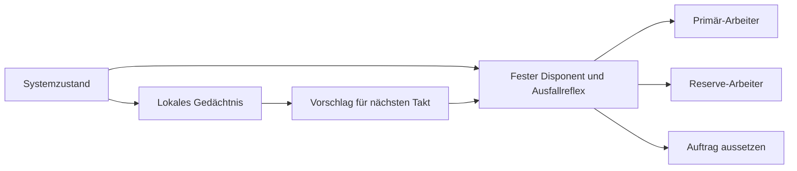

# OSCan: Vom Gedächtnis zur Systementscheidung

Stand 5. November 2026. Grundlage: OSCan 0.4 einschließlich Alex’ Ergänzung „Vokabular, Fassung 1, und weiter Blick“, Commit `8d81287aea19bd7b325876ed0ff074607258f457` in `wolfaa73-jpg/oscan`. Alex’ Lernkern und Firmware bleiben die Vergleichsbasis. Eigener Arbeitszweig: `codex/systemversuch-1`.

## Was dieser Schritt für das Betriebssystem leistet

OSCan soll seine Erfahrungen für eigene Entscheidungen benutzen. Der neue Laufzeitversuch verbindet deshalb einen wahrgenommenen Systemzustand mit der Vergabe eines Arbeitsauftrags. Ein Gedächtnis schlägt vorausschauend eine Reserve vor. Ein fester Disponent prüft den aktuellen Zustand, begrenzt die Aktion und lässt genau einen Arbeiter handeln. Die beiden Arbeiter können als echte lokale Prozesse gestartet werden.

Das ist ein ausführbarer Baustein für ein lernendes Betriebssystem. Bootvorgang, Speicherisolation, Gerätetreiber und präemptives Scheduling übernimmt weiterhin das vorhandene Betriebssystem. Diese Trennung erlaubt, die Lernidee jetzt zu prüfen. Die Datei `systemkern.py` ist daher ein Laufzeitkern dieses Experiments und kein bootfähiger OS-Kernel.



## Ausprobieren

Im Ordner `Alex-Lerngedaechtnis` ausführen. Python ab 3.9, für die vorhandenen Sketch-Tests zusätzlich ein C++11-Compiler. Keine neuen Python-Pakete erforderlich.

```bash
python3 -B -m unittest -v
python3 -B systemlabor.py prozesse
python3 -B systemlabor.py kontrolle --json beispiele/system-ergebnis.json --csv beispiele/system-kontrolle.csv --bericht Systembericht.html
python3 -B systemlabor.py spur beispiele/demo.csv --json eigener-verlauf.json
```

`Systembericht.html` direkt im Browser öffnen. Er enthält alle Familien und Kostenannahmen. Die JSON-Datei enthält Kennzahlen je Spur, Quellen-Hashes, Anpassungszeiten und Intervalle. Eine eigene CSV verwendet `zustand` oder `takt,zustand` wie das bestehende Labor. Eine externe Zustandsfolge wird ausdrücklich nicht automatisch als Feldmessung bezeichnet.

## Vertrag der Laufzeit

- `OK` und `SCHWACH`: Der Primär-Arbeiter ist aktuell nutzbar. Eine Vorwarnung reserviert den zweiten Arbeiter für genau den nächsten logischen Takt.
- `AUSFALL`: Der Primär-Arbeiter ist gesperrt. Eine bereits gültige Reservierung erlaubt den Reserve-Arbeiter. Sonst wird dieser Auftrag ausgesetzt. Ein Ausfall reserviert unabhängig vom Gedächtnis für den Folgetakt.
- `None`: Aktuelles Wissen fehlt. Der Auftrag wird ausgesetzt und die alte Reservierung verworfen. Es wird keine Erfahrung erfunden.
- Jeder Takt vergibt höchstens einen Auftrag und eine Reservierung. Doppelte und rückläufige Takte werden abgewiesen. Eine Lücke oder ein Neustart macht alte Reservierungen ungültig.
- „Ausgesetzt“ bedeutet in diesem Versuch nicht ausgeführt. Eine Warteschlange mit späterem Nachholen gehört noch nicht zum Modell.
- Der feste Disponent nimmt nur Daten und eng begrenzte Entscheidungen entgegen. Die Arbeiter berechnen SHA-256 für feste Testaufträge. Sie führen keine vom Gedächtnis erzeugten Shellbefehle aus.

Die Trennung zwischen Regeln und Gedächtnis ist hier eine Codegrenze. Python-Objekte sind kein Schutz gegen einen Angreifer im selben Prozess. Für die spätere OS-Architektur braucht die feste Instanz eine tatsächlich geschützte Grenze. Alle Aufrufe gehören in einen seriellen Ereignisablauf.

## Vergleichsaufbau

Sechs Verfahren: nur Ausfallreflex, feste SCHWACH-Regel, Lernen ohne Verblassen, zeitliches Verblassen, Kontext-Verblassen, Erbe plus Kontext. Alle erhalten dieselbe Spur in zeitlicher Reihenfolge. Das aktuelle Ergebnis darf in die Erfahrung eingehen, bevor die nächste Vorhersage entsteht. Die nächste Beobachtung und die Generatorphase sind dem Entscheider dabei unbekannt. Ein Präfix-Test prüft, dass unterschiedliche Zukünfte die bisherigen Entscheidungen nicht verändern.

Die sechs bereits vorhandenen Generatorfamilien laufen auf je 50 zusätzlichen Seeds 2000–2049: 300 Spuren mit 144.000 Zuständen und insgesamt 864.000 Regelentscheidungen. Die Parameter aus 0.4 wurden unverändert übernommen: Warnschwelle 0,6, Mindestbeleg 3, Zeit-Halbwert 24, Kontext-Halbwert 6, Erbe 3. Die neuen Seeds prüfen zusätzliche Zufallsverläufe innerhalb bekannter Modelle. Sie sind keine unabhängige Bestätigung der Modellannahmen.

Ein Voralarm gilt für genau den nächsten Takt und wird nur bei bekanntem, direkt folgendem Zustand bewertet. Offene Enden, Lücken und unbekannte Zustände erzeugen weder Treffer noch Fehlalarme. Recall, Präzision und Fehlalarmrate sind bei fehlendem Nenner `null`. Fehlalarmrate bezieht sich auf bekannte negative Vorhersagegelegenheiten; Präzision bezieht sich auf bewertete Warnungen. Ausfallbeginn bei fehlendem Vorgänger wird separat gezählt. Mehrtakt-Ausfälle erzeugen nicht wiederholt einen neuen Beginn.

**Vorwarnzeit:** Jeder Treffer hat genau einen logischen Takt Vorsprung. Dieser Kern lernt keine längeren Horizonte. Eine Umrechnung in nutzbare Millisekunden benötigt den realen Erfassungszeitpunkt, Transportverzug und Ausführungsdauer. Die fünf Sekunden Antwortfrist der Prozessprobe sind lediglich eine Prüfgrenze und keine OS-Echtzeitgarantie.

**Anpassung:** Eine getrennte, deterministische Spur enthält je 40 gefährliche, harmlose und erneut gefährliche SCHWACH-Signale. Gemessen wird die erste Serie von drei passenden Entscheidungen innerhalb jeder Phase. Das beschreibt die Reaktionsgeschwindigkeit unter dieser konkreten Definition, nicht dauerhafte Stabilität unter beliebigen Störungen.

**Kosten:** Ein belegter Reservetakt kostet eine Modelleinheit, ein ausgesetzter Auftrag wahlweise 1, 5, 10 oder 20. Unbekannte reale Kosten werden nicht nachträglich zur Auswahl eines Gewinners benutzt. Alle vier Ergebnisse sind enthalten. Die Differenzen zur festen Regel erhalten 95%-Perzentilintervalle aus 1.000 Bootstrap-Wiederholungen ganzer gepaarter Spuren je Familie. Einzelne korrelierte Takte werden nicht unabhängig resampelt. Diese Intervalle sind bedingt auf das Generatormodell; die vielen Vergleiche sind keine für Mehrfachtests korrigierten Signifikanzentscheidungen.

## Ergebnisse und Konsequenzen

Die folgenden Zahlen sind Summen über jeweils 50 Spuren des synthetischen Kontrolllaufs:

| Familie und Regel | Richtige Vorwarnungen | Fehlalarme | Verpasste Vorwarnungen |
|---|---:|---:|---:|
| Stabil, fest | 4.513 | 808 | 218 |
| Stabil, Erbe + Kontext | 4.513 | 808 | 218 |
| Bedeutungswechsel, fest | 2.403 | 3.488 | 230 |
| Bedeutungswechsel, Erbe + Kontext | 2.285 | 688 | 348 |
| Rückkehr, fest | 3.085 | 2.629 | 225 |
| Rückkehr, Erbe + Kontext | 2.675 | 764 | 635 |
| Selten, fest | 485 | 91 | 321 |
| Selten, zeitliches Verblassen | 1 | 0 | 805 |
| Selten, Erbe + Kontext | 483 | 91 | 323 |

Beim Bedeutungswechsel spart Erbe + Kontext 2.800 Fehlalarme und 2.918 Reservetakte, verpasst aber 118 zusätzliche Ausfallvorwarnungen. Im gewählten Ressourcenmodell kippt der mittlere Kostenvorteil bei etwa 24,7 Reservetakt-Kosten pro zusätzlich ausgesetztem Auftrag. Das ist eine bedingte Kostenrechnung, keine Empfehlung für reale Arbeitslasten. Bei r = 5 liegt die Kostendifferenz bei −97,0 Einheiten je 1.000 Takte, das gepaarte Intervall bei etwa −103,0 bis −91,0.

Bei seltenen Vorzeichen verwirft das zeitliche Verblassen fast alle nützlichen Belege zu früh. In einer Umgebung ohne Vorzeichen kann ein Übergangsgedächtnis keine verlässliche Vorwarnung erfinden. Die feste Regel trifft dort gelegentlich durch häufiges Warnen und erzeugt zugleich sehr viele Fehlalarme. Alle Gegenbeispiele stehen im Bericht.

In der deterministischen Anpassungsprobe bestätigt Erbe + Kontext die Entwarnung nach 10 und die Rückkehr nach 9 schwachen Signalen. Lernen ohne Verblassen benötigt 30 beziehungsweise 23. Die feste Regel folgt der Entwarnung überhaupt nicht. Der Lerngewinn liegt damit in der Anpassung des Handelns; er ist kein universeller Genauigkeitsgewinn.

## Tatsächlich geprüfte Ausführung im Systemversuch 1

Alle 77 Tests bestanden: 48 Tests der aktuellen Basis, 15 Verbundtests und 14 neue Systemtests. Die Warnbilanz des neuen Ablaufs stimmt auf allen sechs Familien für jedes Verfahren mit Alex’ bisheriger Auswertung überein. Zusätzliche Prüfungen betreffen Kausalität, fehlendes Wissen, Taktlücken, Neustart, Zählergrenzen, unveränderten Zustand nach ungültigen Eingaben und handgerechnete Kennzahlen. Der HTML-Bericht wurde bei 390 und 1150 Pixel Breite geprüft; die sechs Familientabellen und 120 ausklappbaren Kostenvergleiche sind vorhanden und die Seite läuft nicht horizontal über.

Die Prozessprobe startet genau zwei eigene lokale Arbeiter. In 720 logischen Takten liefen 640 Aufträge auf dem Primär- und 74 auf dem Reserve-Arbeiter. Alle 714 Antworten wurden anhand der Auftragsnummer und ihres SHA-256-Ergebnisses geprüft. Sechs Aufträge wurden gemäß der Regel ausgesetzt; das sind keine fehlgeschlagenen Tests. Die Ressourcenverfügbarkeit stammt weiterhin aus der deterministischen Spur. Beide Prozesse sind bereits gestartet; Kosten für echtes Aufwecken, Energie oder einen realen Prozessausfall sind damit noch nicht gemessen. Beide Prozesse werden nach dem Versuch beendet.

## Anschluss an Alex’ aktuelles Vokabular

Alex’ neuer Stand enthält in `vokabular.py` zehn feste Wörter und ein Wortgedächtnis mit mehrtaktigem Horizont. Unser Disponent verwendet weiterhin die drei Oberbegriffe aus `kern.py` und plant genau einen Takt voraus. Die Ergebnisse dieses Systemversuchs vergleichen deshalb die bisherigen sechs Regeln, nicht das neue Wortgedächtnis. Dessen zusätzliche Tests sind Bestandteil der gemeinsamen 77 Prüfungen.

Für die spätere Verbindung kann `vokabular.grob()` bestätigte Körperwörter auf die drei Zustände abbilden. Das OC-Datenformat dieses Verbundversuchs akzeptiert weiterhin nur Zustandsnummern 1 bis 3. Wörter ab Nummer 5 dürfen daher nicht ungeprüft als Zustand übertragen werden. Eine Warnung „binnen 30 Takten“ braucht außerdem einen eigenen Zeitvertrag für die Reservierung; sie darf nicht stillschweigend als Vorhersage für genau den nächsten Takt behandelt werden. Diese Adapter sind noch nicht implementiert.

## Verbindung zum bisherigen Verbund

`verbund.py` und `Verbund.html` liefern den ergänzenden Versuch mit Knotenidentitäten, Sitzungen und ablaufenden Meldungen. Die gemeinsame Verbindung dieser Bausteine ist inzwischen in `verbundsystem.py` umgesetzt; Ablauf und Grenzen stehen in [ANSCHLUSS-UEBERGABE.md](ANSCHLUSS-UEBERGABE.md). Dort wird nur in den sendenden Knoten gelernt. Der gemeinsame Versuch benutzt OC-Pakete über einen simulierten Kanal und echte lokale Arbeiter.

Für den Anschluss muss festgelegt werden, wo gelernt wird: entweder im sendenden Organ oder in der zentralen Laufzeit. Bereits gelernte Entscheidungen dürfen auf dem Empfangsweg keine zweite Beobachtung erzeugen. `Sicht.zustand is None` muss eine ausstehende Reservierung ungültig machen. Ein Neustart verwirft Sitzungen und Aktionspläne, selbst wenn das Gedächtnis über `neustart.py` wiederhergestellt wird. Ein Statuspaket enthält derzeit weder Ressourcenkapazität noch Aktionsbestätigung; diese Felder dürfen nicht stillschweigend hinzugedeutet werden.

## Nächster Auftrag für Alex und Claude

1. Tests, Prozessprobe und Kontrollbericht reproduzieren. Die Hauptentwicklung erst nach Prüfung übernehmen.
2. Eine konkrete OS-Aufgabe wählen, beispielsweise einen Hintergrundauftrag zwischen zwei eigenen Arbeitern verteilen. Deadline, Reservekosten und erlaubte Aussetzzeit vorab festlegen.
3. Einen Backend-Vertrag einführen: Fähigkeiten melden, Auftrag mit ID annehmen, Abschluss oder Fehler bestätigen. Die feste Instanz begrenzt Kapazität und führt einen eindeutigen Auftragszustand; Wiederholungen dürfen keine doppelte Wirkung haben.
4. Dann den Verbundkanal anbinden und Ausfall, veraltetes Wissen sowie Neustart während eines Auftrags prüfen. Lernen und Planen dürfen den festen Fehlerpfad nicht aushebeln.
5. Erst auf dieser Grundlage echte Durchlaufzeit und Ressourcenverbrauch vergleichen. Die erste reale Arbeitslast dient der Entwicklung; eine zweite, zeitlich getrennte Arbeitslast prüft eingefrorene Einstellungen. Erst danach eine Standardregel wählen.

Ein neuer Scheduler, geschützter Gedächtnisraum und späterer Bootpfad bleiben Schritte der OS-Architektur. Der vorliegende Versuch liefert dafür einen prüfbaren Entscheidungsablauf, einen Aktionsvertrag im Kleinen und die Gegenbeispiele, an denen sich eine bessere Regel messen lassen muss.
